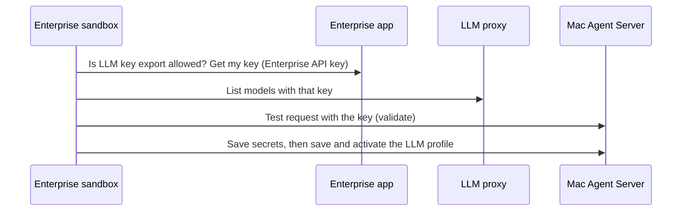

{/* GENERATED from OpenHands/enterprise-cookbook@a086af21032e08f312b3fe1f8701cd83d585f8ff (macos-agent-canvas/README.md). Edit the source, not this file. */}

<Card title="View source on GitHub" icon="github" href="https://github.com/OpenHands/enterprise-cookbook/tree/a086af21032e08f312b3fe1f8701cd83d585f8ff/macos-agent-canvas" horizontal />

An operator installs OpenHands Agent Server on a Mac over SSH from their own workstation.
An OpenHands Enterprise conversation then calls its REST API over HTTPS from a sandbox,
using a session key saved in Enterprise `Settings > Secrets`. The default route uses the
Mac's TLS front end and a pinned certificate on a private network. For a temporary demo
when the sandbox cannot reach the Mac's network, an optional ngrok endpoint can provide
HTTPS to the same loopback-only Agent Server without changing the sandbox's REST client.
Enterprise does **not** SSH to the Mac or receive the operator's SSH credentials. The Mac
is a separate host, not an Enterprise sandbox. Automated tests and a real launchd install,
authenticated local/LAN TLS, stop/start, reinstall, source allow-list, and purge have passed
on macOS 15.6.1 (arm64). The Mac's application firewall was disabled during testing.
Reboot persistence, private-network sandbox access, and Replicated VM integration remain
unverified. From an OpenHands Cloud sandbox, a real Mac Agent Server behind ngrok passed
session-key authentication, LLM sync using an HTTPS LiteLLM proxy, and a tool-free
conversation that answered a science dad joke. Tool-enabled delegation is not yet tested
on the Mac.

<Warning>
  **The session key is all it takes to run commands on the Mac as its service user.** HTTPS
  protects it in transit. On a private network, the sandbox pins the Mac's certificate and
  the firewall and `--allow-from` limit who can reach the TLS port. An ngrok demo puts the
  API on a public HTTPS address; anyone can try the key, so use it only temporarily, keep
  ngrok's request inspection off, and stop the tunnel after testing. Ngrok terminates TLS
  and can see requests and secrets; the Mac receives HTTP on loopback. Consider a dedicated
  service account. Showing the key in the operator's terminal exposes it to terminal
  scrollback, screen sharing, and recordings.
</Warning>

## How It Works

```mermaid
sequenceDiagram
    participant O as Operator workstation
    participant M as Mac over operator SSH
    participant V as Enterprise secret settings
    participant E as Enterprise sandbox
    participant T as TLS front end on the Mac (port 18443)
    participant A as Agent Server on the Mac (127.0.0.1:18100)
    O->>M: install --tls-name (authorize sudo)
    M->>A: Register launchd services; generate session key and certificate
    O->>V: Paste session key and certificate into Settings > Secrets
    E->>T: HTTPS request with key header; only the saved certificate is trusted
    T->>A: The same bytes over loopback
    E->>T: Copy LLM profile and chosen secrets (sync_llm.py)
```

The Agent Server speaks plain HTTP, and calls itself over plain HTTP on loopback, so it cannot
terminate TLS itself. In the **private-network flow shown above**, the installer binds it to
`127.0.0.1` and runs [`tls_front.py`](https://github.com/OpenHands/enterprise-cookbook/blob/a086af21032e08f312b3fe1f8701cd83d585f8ff/macos-agent-canvas/tls_front.py), a small TLS tunnel built on the Python
standard library, as a second launchd service on a network port. It copies bytes in both
directions without parsing them, so REST calls and WebSockets both work. In the **ngrok demo
flow**, the operator instead runs ngrok on the Mac: the sandbox connects to ngrok over HTTPS,
and ngrok forwards over its tunnel to the same `127.0.0.1:18100` HTTP listener. Neither flow
needs inbound SSH from Enterprise or a publicly bound Agent Server listener.

The installer also generates an independent `OH_SECRET_KEY` to encrypt the Mac server's stored
secrets. The session key authenticates HTTP clients; it is **not** an LLM provider key or an SSH
key. See the [install skill](https://github.com/OpenHands/enterprise-cookbook/blob/a086af21032e08f312b3fe1f8701cd83d585f8ff/macos-agent-canvas/skills/macos-agent-server-install/SKILL.md) for the agent-facing
checklist, the [LLM setup skill](https://github.com/OpenHands/enterprise-cookbook/blob/a086af21032e08f312b3fe1f8701cd83d585f8ff/macos-agent-canvas/skills/macos-agent-server-llm-setup/SKILL.md) for giving the
Mac an LLM and secrets, and the [operations skill](https://github.com/OpenHands/enterprise-cookbook/blob/a086af21032e08f312b3fe1f8701cd83d585f8ff/macos-agent-canvas/skills/macos-agent-server-operations/SKILL.md)
for management and delegation. All three are bundled in this recipe's
[plugin](https://github.com/OpenHands/enterprise-cookbook/blob/a086af21032e08f312b3fe1f8701cd83d585f8ff/macos-agent-canvas/.plugin/plugin.json), which is listed in the repository's
[marketplace](https://github.com/OpenHands/enterprise-cookbook/blob/a086af21032e08f312b3fe1f8701cd83d585f8ff/.plugin/marketplace.json). The existing
[Claude-compatible manifest](https://github.com/OpenHands/enterprise-cookbook/blob/a086af21032e08f312b3fe1f8701cd83d585f8ff/macos-agent-canvas/.claude-plugin/plugin.json) is retained.

## Prerequisites

- The operator has a working SSH login as a **non-root macOS administrator** and can authorize
  `sudo`. Verify the Mac's SSH host key before accepting it. These credentials remain with the
  operator, never in Enterprise Secrets or an agent conversation.
- The Mac has `git`, `curl`, `openssl`, and `uv` available to the service account. The installer
  creates a Python 3.12 virtual environment. By default, the service runs as the installing
  account; for a dedicated non-admin service account, provision its home and `uv` first and
  pass `--user ACCOUNT` to the installer. That account's files and processes will be available
  to anyone with the session key. The operator still runs the installer and authorizes sudo.
- For the private-network route, choose the **host name or IP address that Enterprise
  sandboxes use to reach the Mac**. The installer issues the certificate for that name, and
  clients refuse any other name. It must resolve from the sandboxes. The customer's firewall
  must allow TCP port `18443` **only from the intended Enterprise sandbox network**. Verify
  sandbox egress and the Mac's application firewall; operator SSH does not prove reachability.
- For the temporary ngrok demo route, install and authenticate the [ngrok agent](https://ngrok.com/docs/agent/)
  **on the Mac**, and use an available HTTPS hostname in your own ngrok account. Ngrok needs
  outbound internet access from the Mac; the sandbox needs outbound HTTPS to that hostname.
  No inbound Mac port, public HTTP bind, Enterprise SSH credential, or network routing change
  is needed. An account's default dev hostname may already be in use; choose another
  available hostname rather than pooling with an existing endpoint.
- The operator has Enterprise browser access to the intended organization and
  `Settings > Secrets`. A member can save a personal secret; an Admin/Owner is required for an
  organization-shared secret. A new conversation must have the secrets in its scope and, if
  applicable, selected by its Agent Profile.

## Install on the Mac

From a terminal on **your own workstation**, SSH into the Mac as the administrator. Verify its
SSH host key before accepting it:

```bash
export MAC_SSH=admin@mac.example.net
ssh "$MAC_SSH"
```

In that **Mac shell**, clone the recipe. Until this recipe is merged, use the
`macOS-agent-canvas` branch; change it to `main` after publication. Review the source before
installing. Do not pipe a downloaded script to a shell:

```bash
git clone --branch macOS-agent-canvas https://github.com/OpenHands/enterprise-cookbook.git "$HOME/enterprise-cookbook" &&
  cd "$HOME/enterprise-cookbook/macos-agent-canvas"
```

Choose **one** transport. The installer runs as the **operator**, not root, and prompts for the
Mac administrator's sudo password when registering or starting the launchd service(s). Both
choices install in `~/.openhands-enterprise-mac-agent`, bind the Agent Server to
`127.0.0.1:18100`, and generate a session key and separate encryption key **without printing
either**.

<Tabs>
  <Tab title="Private network (Mac TLS front end)">
    Replace `mac.internal.example` with the name the sandboxes use for the Mac:

    ```bash
    ./oh-agent-server.sh install --tls-name mac.internal.example
    ```

    The installer creates a self-signed certificate for that name (about 825 days, private key mode
    `600`) and registers **two** launchd services, including the TLS front end on port `18443`.
    Example summary:

    ```text
    ==> Installed and running
    ==> Starting the TLS front end

      Agent Server: https://mac.internal.example:18443 (TLS front end)
      Plain HTTP:   http://127.0.0.1:18100 (this Mac only)
      Certificate:  names=mac.internal.example,localhost,127.0.0.1 expires=2029-02-13 days_left=825 fingerprint=SHA256:…
      Allowed from: any source address
    ```
  </Tab>

  <Tab title="Temporary ngrok demo (no Mac TLS front end)">
    Install just the loopback-only Agent Server as **one** launchd service:

    ```bash
    ./oh-agent-server.sh install --no-tls --host 127.0.0.1
    ```

    On the **Mac**, in a separate terminal, start the already authenticated ngrok agent. Replace
    `YOUR_NGROK_HOSTNAME` with an available hostname in your own ngrok account (not the literal
    `{$random}` dashboard template). Leave this process running during the demo:

    ```bash
    ngrok http 127.0.0.1:18100 --url https://YOUR_NGROK_HOSTNAME --inspect=false
    ```

    Ngrok terminates public HTTPS and forwards to the Mac's loopback-only HTTP listener; its
    endpoint is independent of the launchd service. Do **not** bind the Agent Server to `0.0.0.0`,
    use `--pooling-enabled` with another endpoint, enable request inspection, or use an
    `--allow-insecure-http` client. Stop ngrok after the demo. The default ngrok dev hostname can
    already be occupied; use an available hostname instead of interrupting an existing endpoint.
  </Tab>
</Tabs>

Options you can add to the install command:

| Option                      | Effect                                                                                                                                                                                             |
| --------------------------- | -------------------------------------------------------------------------------------------------------------------------------------------------------------------------------------------------- |
| `--allow-from CIDR[,CIDR…]` | The TLS front end accepts connections only from these networks, in addition to your firewall. The Mac sees the address the sandbox's traffic leaves your network from, which may be a NAT gateway. |
| `--tls-port N`              | Use a different TLS port (default `18443`).                                                                                                                                                        |
| `--user ACCOUNT`            | Run as an existing dedicated service account. Verify `uv` is available to it first.                                                                                                                |
| `--no-tls`                  | Remove the Mac TLS front end; use only when a separate HTTPS proxy such as ngrok forwards to `127.0.0.1:18100`. Do not bind plain HTTP to the network.                                             |

Reinstalling with the same user and path keeps the keys, ports, TLS settings, and (in the
private-network flow) the certificate unless you override them, so the saved secrets stay
valid. Switching routes requires explicitly installing with `--no-tls` or `--tls-name NAME`;
`install` without either option preserves the previous transport. If this checkout already
exists, inspect its branch and changes, update it with `git fetch` / `git checkout`, and install
from `macOS-agent-canvas`.

<Note>
  Already have a reverse proxy or load balancer with a certificate your sandboxes trust? Skip
  `--tls-name` and run `./oh-agent-server.sh install --host 127.0.0.1`, then point the proxy at
  `127.0.0.1:18100`. Use the proxy's address as the target below. You need
  `MAC_AGENT_SERVER_CA` only if the proxy's certificate comes from a private CA.
</Note>

Check the install from the same Mac shell. The installer waits for its launchd service(s).
`status` checks the Agent Server; with the private-network route it also shows the TLS
service, certificate expiry, and a pinned HTTPS check. It does **not** check an external
ngrok process or the sandbox's network path:

```bash
./oh-agent-server.sh status
curl -fsS --max-time 3 http://127.0.0.1:18100/ready
```

A successful `/ready` response confirms the process, **not** API authentication, network
reachability from an Enterprise sandbox, or a configured LLM.

## Save the Session Key in Enterprise

In the **Mac shell on the operator workstation**, deliberately display the generated key once:

```bash
./oh-agent-server.sh key
```

The key appears in that terminal's output. Copy it directly into the Enterprise **web UI**:
select the intended organization, open `Settings > Secrets`, choose `Add a new secret`, name it
`MAC_AGENT_SERVER_KEY`, and paste the value into the **value** field. For a personal secret,
leave `Share with organization` unchecked; only an Admin/Owner should check it when every member
of that organization is authorized to control the Mac. Confirm the secret name appears.
Do not paste the key into chat, a command argument, a URL, Git, or an agent transcript. Prevent
terminal recording or screen sharing while displaying it; clear the workstation clipboard and
terminal scrollback when finished. Enterprise settings will not show the stored value again.
(`key --copy` copies to the clipboard **of the Mac**, which helps only when you are at the Mac.)

<Tabs>
  <Tab title="Private network (Mac TLS front end)">
    Also save the certificate as `MAC_AGENT_SERVER_CA` with the same scope:

    ```bash
    ./oh-agent-server.sh ca
    ```

    ```text
    LS0tLS1CRUdJTiBDRVJUSUZJQ0FURS0tLS0tCk1JSUJ…
    ```

    This prints the public certificate as **one line of base64**, because the secret form is a
    single-line field. The certificate is not secret, but saving it as a secret makes it available
    to the sandbox without putting it in a prompt. `install` and `status` print the certificate's
    fingerprint, and `./oh-agent-server.sh ca --pem` shows the PEM text, if you want to inspect it.
  </Tab>

  <Tab title="Temporary ngrok demo">
    Save **only** `MAC_AGENT_SERVER_KEY`. Ngrok presents a certificate signed by a public CA, so
    the sandbox's default trust store verifies it; the Mac's `ca` command is unavailable after
    `install --no-tls`. Do not create or reuse `MAC_AGENT_SERVER_CA` for this route.
  </Tab>
</Tabs>

If a required secret name already exists, **stop**: do not overwrite the Mac key or create a
second value unintentionally. Replacing a saved value in the UI requires deleting and
re-adding that secret, and existing conversations may retain an older value. Key rotation is
outside this first-install flow. See [Enterprise Secrets Management](/enterprise/secrets-management)
for scope and rotation details. No Enterprise SSH credential is needed. In the ngrok demo,
keep the ngrok process running until the sandbox check is finished.

## Verify from an Enterprise Sandbox

Start a **new** Enterprise conversation in the organization with access to the saved secret(s).
If using this recipe as a plugin, include the following `plugins` field in the
conversation-start request; this is JSON for the request, **not** a shell command:

```json
{
  "plugins": [{
    "source": "github:OpenHands/enterprise-cookbook",
    "ref": "macOS-agent-canvas",
    "repo_path": "macos-agent-canvas"
  }]
}
```

See [`load-plugin`](/cookbook/load-plugin) for a full conversation-start example. Plugins provide
instructions, not credentials or network access. In the **Enterprise sandbox's terminal**,
run the appropriate **read-only, authenticated** REST check. The secrets are exported into the
command environment when referenced by name; neither the command nor its output displays
their values.

<Tabs>
  <Tab title="Private network (Mac TLS front end)">
    Replace `mac.internal.example` with the name given to the installer. `curl` trusts only the
    certificate saved in `MAC_AGENT_SERVER_CA`:

    ```bash
    curl -fsS --max-time 10 --output /dev/null \
      --cacert <(printf '%s' "$MAC_AGENT_SERVER_CA" | base64 -d) \
      -H "X-Session-API-Key: $MAC_AGENT_SERVER_KEY" \
      'https://mac.internal.example:18443/api/settings' &&
      printf 'Authenticated Mac Agent Server API is reachable.\n'
    ```
  </Tab>

  <Tab title="Temporary ngrok demo">
    Replace `YOUR_NGROK_HOSTNAME` with the live ngrok endpoint's hostname. Standard system CA trust
    verifies ngrok's public certificate; do not use `--insecure` or the Mac CA secret:

    ```bash
    curl -fsS --max-time 10 --output /dev/null \
      -H "X-Session-API-Key: $MAC_AGENT_SERVER_KEY" \
      'https://YOUR_NGROK_HOSTNAME/api/settings' &&
      printf 'Authenticated Mac Agent Server API is reachable via ngrok.\n'
    ```
  </Tab>
</Tabs>

`/api/settings` requires the session key; suppressing its response avoids displaying settings
in the transcript. If this fails, stop and check the hostname and certificate, sandbox egress,
secret scope, and Agent Profile selection. For the private route also check the firewall and
`--allow-from`; for ngrok check its agent is still running and its endpoint is online. Do not
paste the key into chat to debug it. A successful request proves this sandbox can authenticate
to the Mac API, **not** that the Mac has an LLM profile or can run an agent conversation.

<Info>
  On macOS 15.6.1, both launchd services ran and authenticated REST worked locally and via
  the Mac's private LAN address. From an OpenHands Cloud sandbox, authenticated access to a
  real Agent Server over ngrok, LLM sync, and a tool-free conversation have also passed.
  The application firewall was off during private-network testing; a client on a second
  machine, enabled-firewall behavior, and direct sandbox-to-Mac **private-network** access
  remain unverified. Check the intended route from your own sandbox.
</Info>

## Give the Mac an LLM and Secrets

The Mac Agent Server has no LLM until you give it one. The `sync_llm.py` script, bundled in the
[LLM setup skill](https://github.com/OpenHands/enterprise-cookbook/blob/a086af21032e08f312b3fe1f8701cd83d585f8ff/macos-agent-canvas/skills/macos-agent-server-llm-setup/SKILL.md), runs in an Enterprise
conversation and copies your LLM access and the secrets you choose to the Mac. You never see or
paste the LLM key.



**Before you start:**

- An Enterprise administrator turns on **Enable LLM Key Export (BYOR)** in the Replicated Admin
  Console. It is off by default because it lets users take their LLM key out of the cluster.
  The script stops with that instruction when it is off.
- The Mac can reach the LLM proxy at `https://llm-proxy.<your base domain>`, the LLM Proxy
  Hostname shown in the Admin Console. A Replicated installation publishes it with a
  certificate. This recipe covers Replicated VM installations only.
- The secrets you want on the Mac are saved in Enterprise `Settings > Secrets` and are in the
  conversation's scope.

Start a new conversation with the plugin loaded, as in the previous section, and ask the agent
to give the Mac an LLM. The [LLM setup skill](https://github.com/OpenHands/enterprise-cookbook/blob/a086af21032e08f312b3fe1f8701cd83d585f8ff/macos-agent-canvas/skills/macos-agent-server-llm-setup/SKILL.md)
provides its instructions; the equivalent commands below run from the plugin's skill
directory. The key names must appear in the command so the sandbox injects them.

<Tabs>
  <Tab title="Private network (Mac TLS front end)">
    ```bash
    python3 scripts/sync_llm.py --target https://mac.internal.example:18443 \
      --api-key-env OPENHANDS_API_KEY --target-key-env MAC_AGENT_SERVER_KEY \
      --ca-cert-env MAC_AGENT_SERVER_CA --list-models
    python3 scripts/sync_llm.py --target https://mac.internal.example:18443 \
      --api-key-env OPENHANDS_API_KEY --target-key-env MAC_AGENT_SERVER_KEY \
      --ca-cert-env MAC_AGENT_SERVER_CA \
      --model claude-sonnet-4-5 --secret GITHUB_TOKEN --dry-run
    ```
  </Tab>

  <Tab title="Temporary ngrok demo">
    Use the HTTPS ngrok hostname. The script verifies its public certificate with the standard
    trust store; do **not** pass `--ca-cert-env` or `--allow-insecure-http`:

    ```bash
    python3 scripts/sync_llm.py --target https://YOUR_NGROK_HOSTNAME \
      --api-key-env OPENHANDS_API_KEY --target-key-env MAC_AGENT_SERVER_KEY \
      --list-models
    python3 scripts/sync_llm.py --target https://YOUR_NGROK_HOSTNAME \
      --api-key-env OPENHANDS_API_KEY --target-key-env MAC_AGENT_SERVER_KEY \
      --model claude-sonnet-4-5 --secret GITHUB_TOKEN --dry-run
    ```
  </Tab>
</Tabs>

Run the second command for your chosen route without `--dry-run` to apply it. It prints the
steps, never a value (example from the private-network route):

```text
ok   LLM key export is allowed
ok   Mac Agent Server reachable at https://mac.internal.example:18443
ok   the key works at https://llm-proxy.example.com
ok   the Mac completed a test request through the proxy
ok   saved 1 secret(s) on the Mac
ok   LLM profile 'enterprise' saved and active on the Mac
```

The Mac checks the key before anything is saved, so a bad key or unreachable proxy changes
nothing. For the private-network route the script pins `MAC_AGENT_SERVER_CA`; for ngrok it
uses the standard public CA trust store. It refuses a plain `http://` target unless you pass
`--allow-insecure-http`, which you should not need. If you refresh your key in Settings, or
the installation resets its LLM proxy database, the Mac's copy stops working. Run the script
with `--check` to find out, and run it again without `--check` to fix it. Pass
`--enterprise-url` or `--llm-base-url` if the installation uses custom hostnames.

<Info>
  The script's tests use local stand-ins. It has also run against OpenHands Cloud (LLM key
  export and an HTTPS LLM proxy) and a real Mac Agent Server through ngrok with
  `gpt-6.1-sol`; the Mac completed a test request. A separate run used this recipe's TLS
  front end on Linux. It has not been validated against a Replicated VM installation. Check
  the correct LLM Proxy Hostname in the Admin Console; use `--llm-base-url` for custom
  hostnames. Never fall back to plain HTTP to work around DNS or certificate errors.
</Info>

## Delegate a Conversation on the Mac

The [operations skill](https://github.com/OpenHands/enterprise-cookbook/blob/a086af21032e08f312b3fe1f8701cd83d585f8ff/macos-agent-canvas/skills/macos-agent-server-operations/SKILL.md) bundles
[`scripts/delegate.py`](https://github.com/OpenHands/enterprise-cookbook/blob/a086af21032e08f312b3fe1f8701cd83d585f8ff/macos-agent-canvas/skills/macos-agent-server-operations/scripts/delegate.py),
which starts **one** remote conversation and polls its status from an Enterprise sandbox.
Confirm the Mac service user, the **absolute Mac workspace** (not the Enterprise sandbox
path), the exact task, whether any tools are necessary, and the sensitivity of files it
might access. The default has no tools, no extra secrets, no repository worktree, a
10-iteration cap, and a two-minute polling deadline. A workspace path alone does **not**
restrict filesystem access for an agent with tools; Mac tools run as the service user
without container isolation. Never include secrets in the prompt or command arguments.
Check that the Mac's active LLM profile works with `sync_llm.py --check` before delegating.

Run these examples from the plugin's `macos-agent-canvas/` directory in the **Enterprise
sandbox**, after confirming `/tmp` is the intended Mac workspace. Both only request a
joke and give the agent **zero tools**:

<Tabs>
  <Tab title="Private network (Mac TLS front end)">
    ```bash
    python3 skills/macos-agent-server-operations/scripts/delegate.py \
      --target https://mac.internal.example:18443 \
      --target-key-env MAC_AGENT_SERVER_KEY --ca-cert-env MAC_AGENT_SERVER_CA \
      --workspace /tmp --prompt 'Tell me one short dad joke about science.'
    ```
  </Tab>

  <Tab title="Temporary ngrok demo">
    ```bash
    python3 skills/macos-agent-server-operations/scripts/delegate.py \
      --target https://YOUR_NGROK_HOSTNAME \
      --target-key-env MAC_AGENT_SERVER_KEY \
      --workspace /tmp --prompt 'Tell me one short dad joke about science.'
    ```
  </Tab>
</Tabs>

Only add `--tool terminal`, `--tool file_editor`, or `--tool task_tracker` after the user
approves what that Mac account may do. The script checks the active profile, reads
`GET /api/settings` with `X-Expose-Secrets: encrypted`, forwards the encrypted LLM
configuration with `secrets_encrypted: true`, and sends an `initial_message` with
`run: true`. It does **not** fetch plaintext profile credentials, forward the sandbox's
secrets or MCP configuration, or need a separate `/run` call. It then polls
`GET /api/conversations/{id}` until `finished`; `idle` alone is not completion. On
success it reads only the latest agent text from `GET /api/conversations/{id}/events/search`
(`items`, not `events`) rather than printing raw events or encrypted reasoning content.

The script prints the conversation ID when it is created. If polling times out, the
conversation may still be running; the script does not stop or recreate it. Investigate
`error`, `stuck`, or confirmation-required statuses using that ID, rather than blindly
retrying the create request. For example, inspect only the status (not raw settings):

```bash
curl -fsS -H "X-Session-API-Key: $MAC_AGENT_SERVER_KEY" \
  'https://YOUR_NGROK_HOSTNAME/api/conversations/CONVERSATION_ID' \
  | python3 -c 'import json,sys; print(json.load(sys.stdin)["execution_status"])'
```

A tool-free joke conversation using `gpt-6.1-sol` finished on the real Mac through ngrok;
the helper's TLS, payload, error, and polling paths have offline loopback tests. Running
a tool-enabled task through this helper on the Mac remains unverified.

## Manage the Service

Run these from your operator workstation; each SSH command uses the Mac checkout (and a
pseudo-terminal when sudo may prompt):

```bash
ssh "$MAC_SSH" 'cd "$HOME/enterprise-cookbook/macos-agent-canvas" && ./oh-agent-server.sh status'
ssh "$MAC_SSH" 'cd "$HOME/enterprise-cookbook/macos-agent-canvas" && ./oh-agent-server.sh logs'
ssh "$MAC_SSH" 'cd "$HOME/enterprise-cookbook/macos-agent-canvas" && ./oh-agent-server.sh logs --tls'
ssh -t "$MAC_SSH" 'cd "$HOME/enterprise-cookbook/macos-agent-canvas" && ./oh-agent-server.sh restart'
```

`start`, `stop`, and `restart` act on the installed launchd service(s), **not** ngrok. `start`
re-enables startup at boot, `stop` disables it until a later `start`, and `restart` preserves
the key. `logs` shows the Agent Server's log; `logs --tls` is only for the Mac TLS front end.
In the demo route the operator manages ngrok separately and must stop it when testing ends.
`remove --purge` destroys the installation, any certificate, and conversations; it is not
routine management. `key` displays the credential, so use it only in a private operator
terminal. The default directory is the service user's
`~/.openhands-enterprise-mac-agent` (virtual environment, logs, data, `tls/`,
`config.env`). The launchd wrapper sets `OH_PERSISTENCE_DIR` to this directory's `state/`
for profiles, settings, and secrets; it also keeps conversations, the default workspace,
and worktrees under `data/`. These are separate from the SDK's shared `~/.openhands`.
The install directory and `state/` are mode `700`; `config.env` and the certificate's
private key are mode `600`. `remove --purge` refuses directories not recognized as this
recipe's installations. Changing service users does not migrate keys, certificates,
or conversations. Existing installations are found from their launchd plist and retain
their old directory when upgraded; profiles previously saved in the shared
`~/.openhands` are not automatically moved into the isolated `state/`.

### Certificate Renewal

The certificate is valid for about 825 days. `status` prints the days left. Re-running
`./oh-agent-server.sh install --tls-name NAME` keeps the certificate while it covers `NAME` and
has more than 30 days left, and replaces it otherwise. A replaced certificate has a new
fingerprint, so save the new `./oh-agent-server.sh ca` output in Enterprise afterwards, by
deleting and re-adding the `MAC_AGENT_SERVER_CA` secret. To replace it sooner, delete the
`tls/` directory in the install directory first.

## Later Work

1. **Tool-enabled delegation:** Validate explicit Mac tool permissions and run a scoped
   task on the real Mac, including its workspace and service-account restrictions.
2. **Hardening:** Rotate the session key without re-pasting by hand, add certificates from a
   private CA instead of a self-signed one, and test reboot persistence, the enabled macOS
   application firewall, dedicated service users, and a Replicated VM.

## APIs Used

| Endpoint                                                                                                           | Purpose                                                                                    |
| ------------------------------------------------------------------------------------------------------------------ | ------------------------------------------------------------------------------------------ |
| `GET /ready` on the Mac (`http://127.0.0.1:18100`)                                                                 | Unauthenticated process check                                                              |
| `GET /api/settings` on the Mac (HTTPS)                                                                             | Read-only authenticated REST connectivity check                                            |
| `GET /api/keys/llm/byor/permitted` and `GET /api/keys/llm/byor` on Enterprise                                      | Check that LLM key export is on, then get the user's key                                   |
| `GET /v1/models` on the LLM proxy                                                                                  | List the models the key can use                                                            |
| `POST /api/profiles/{name}/validate`, `POST /api/profiles/{name}`, `POST /api/profiles/{name}/activate` on the Mac | Test, save, and activate the LLM profile                                                   |
| `PUT /api/settings/secrets` on the Mac                                                                             | Save a copied secret                                                                       |
| `GET /api/profiles/{name}` on the Mac                                                                              | Read the stored profile for `--check`                                                      |
| `GET /api/profiles`, `GET /api/settings` with `X-Expose-Secrets: encrypted` on the Mac                             | Check the active profile and retrieve forwardable encrypted agent settings                 |
| `POST /api/conversations` on the Mac                                                                               | Start a scoped conversation with `secrets_encrypted: true` and `initial_message.run: true` |
| `GET /api/conversations/{id}`, `GET /api/conversations/{id}/events/search` on the Mac                              | Poll status and read only the agent text                                                   |

The operator saves the key and certificate via Enterprise `Settings > Secrets`, not an
Enterprise API call.

## Related

<CardGroup cols={2}>
  <Card title="Enterprise Secrets Management" href="/enterprise/secrets-management" icon="book-open">
    Secret scopes and permissions
  </Card>

  <Card title="Agent Server Overview" href="/sdk/guides/agent-server/overview" icon="book-open">
    The Mac's HTTP REST service
  </Card>

  <Card title="aws-secrets-sync" href="/cookbook/aws-secrets-sync" icon="key">
    Another example of personal and organization secrets
  </Card>
</CardGroup>
