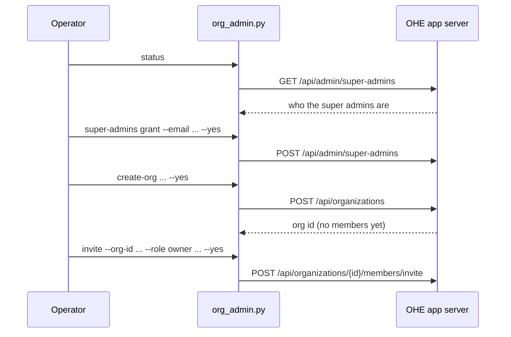

{/* GENERATED from OpenHands/enterprise-cookbook@d2b67f73f38a389f77453cf779e9f52c33fb3cc5 (org-admin/README.md). Edit the source, not this file. */}

<Card title="View source on GitHub" icon="github" href="https://github.com/OpenHands/enterprise-cookbook/tree/d2b67f73f38a389f77453cf779e9f52c33fb3cc5/org-admin" horizontal />

Every OpenHands Enterprise (OHE) user has a [personal workspace](/openhands/usage/cloud/organizations/overview#personal-workspaces-and-team-organizations), and an install that predates organizations has only those. Creating a [team org](/openhands/usage/cloud/organizations/overview#personal-workspaces-and-team-organizations), and putting people in it, is an instance-level action that only a [**super admin**](/openhands/usage/cloud/organizations/overview#super-admins) can take. This example is a small command-line tool for those steps, with the reasons behind each one.

<Note>
  For how personal workspaces, team organizations, and super admins work, see the [Organizations Overview](/openhands/usage/cloud/organizations/overview). For what the VM install and Kubernetes (Helm) settings do, see [Configuring Organizations](/openhands/usage/cloud/organizations/configuring-organizations).
</Note>

## How It Works

A [super admin](/openhands/usage/cloud/organizations/overview#super-admins) is a user whose instance-level role is `admin`. It is separate from the `owner`, `admin` and `member` roles inside an org. It carries the permissions to create orgs, invite people into orgs it is not a member of, and grant or revoke the role itself.



Every instance should already have a super admin. Migration `138` promotes the oldest user if none exists, ordered by `first_login_at`, then `accepted_tos`. That is usually the person who installed OHE, but it is chosen by timestamp, so check.

## Prerequisites

- An OHE install, and an API key for a user. Create one in the app under **Settings > API Keys**.
- To **list** super admins through the API, one of:
  - the key belongs to a super admin, or
  - **Enable OEM User Creation Flow** is on (see [Enabling the Feature](#enabling-the-feature)). It sets `USER_PROVISIONING_ENABLED`, which lets any signed-in user list super admins on OHE **1.62.0 or later**. Earlier versions return 403 to everyone but super admins, even with the toggle on.
- To **grant** the role or **create orgs**, the key must belong to a super admin.
- `pip install requests`

<Warning>
  **Enable OEM User Creation Flow** also registers `POST /api/organizations/provision-user`, which creates Keycloak accounts with passwords and API keys. Org owners and admins can call it for their own org. It redeploys the app. Turn it off again if you only needed it to find the super admin.
</Warning>

## Run It

Set the server and your key. With no subcommand the tool runs a read-only preflight.

```bash
export OH_API_BASE=https://your-ohe-host
export OH_API_KEY=your-api-key
python org_admin.py
```

```text
Signed in as: ada@example.com (user id 3f2c...)
Current org:  user_3f2c..._org (3f2c...)
Role there:   owner

Organizations you belong to:
  3f2c...  personal  user_3f2c..._org
  (Only orgs you are a member of are listed. A super admin is not automatically a member of the orgs it creates.)

Super admins:
  3f2c...  ada@example.com  <- you
```

If listing is forbidden, the tool says so and prints the ways around it.

Every command that changes something is a **dry run** until you add `--yes`. It prints the request and sends nothing.

<Steps>
  <Step title="Promote Another Super Admin">
    The user must have signed in at least once. Granting twice is harmless. Revoking refuses to remove the last super admin.

    ```bash
    python org_admin.py super-admins grant --email grace@example.com --yes
    python org_admin.py super-admins revoke USER_ID --yes
    ```

    Only a current super admin can do this. Finding the super admin does not give you its permissions, so the super admin has to run the command or hand you a key.
  </Step>

  <Step title="Create a Team Org">
    ```bash
    python org_admin.py create-org \
      --name "Acme Engineering" \
      --contact-name "Ada Lovelace" \
      --contact-email ada@example.com \
      --yes
    ```

    The org is created empty. The super admin is not added as a member.
  </Step>

  <Step title="Add the First Owner">
    Pick one of the two.

    <Tabs>
      <Tab title="Invite">
        Works for people who already have accounts. An existing user is added at their next login. If they were on their personal workspace, they land in the new one, and the personal workspace is still there. When no email provider is configured the tool prints the invite link to share.

        ```bash
        python org_admin.py invite --org-id ORG_ID --role owner ada@example.com --yes
        ```
      </Tab>

      <Tab title="Provision">
        Creates the account if needed and returns a password and an API key. It needs **Enable OEM User Creation Flow**. The credentials go to a file with mode 0600, never to the terminal.

        ```bash
        python org_admin.py provision-user \
          --org-id ORG_ID \
          --email ada@example.com \
          --role owner \
          --yes
        ```
      </Tab>
    </Tabs>
  </Step>
</Steps>

## Enabling the Feature

The endpoint is registered only when the operator turns it on. Both install types set `USER_PROVISIONING_ENABLED=true` on the app server:

| Install type      | Where                                     | Setting                                                                                  |
| ----------------- | ----------------------------------------- | ---------------------------------------------------------------------------------------- |
| VM install        | Admin console → Config → Advanced Options | Check **Enable OEM User Creation Flow**, then save the config and deploy the new version |
| Kubernetes (Helm) | Your `values.yaml`                        | `userProvisioning.enabled: true`                                                         |


When it is disabled, `POST /api/organizations/provision-user` returns `404`. Org creation and superadmin management are always available.

For what this setting does across the installation, see [User Provisioning](/openhands/usage/cloud/organizations/configuring-organizations#user-provisioning).

## Find the Super Admin Without the API

The API route is blocked until you have a super admin key or the OEM flag. The database does not need either.

```sql
SELECT u.id, u.email, u.first_login_at
FROM "user" u JOIN role r ON r.id = u.role_id
WHERE r.name = 'admin';
```

If it returns nothing, run the ordering from migration `138` to see who would be picked: the oldest user by `COALESCE(first_login_at, accepted_tos)`.

## Things to Know

- **Listing orgs only shows memberships.** `GET /api/organizations` returns orgs the caller belongs to. Keep the id from `create-org`, because a super admin cannot list the orgs it created.
- **Personal workspaces are not touched.** Nothing here moves or hides personal data. Hiding personal workspaces is a separate setting; see [Hide Personal Workspaces](/openhands/usage/cloud/organizations/configuring-organizations#hide-personal-workspaces).
- **The default-org flags change what a team org means.** See [Default Organization](/openhands/usage/cloud/organizations/configuring-organizations#default-organization). If exactly one team org exists when `default_openhands_org_enabled` is later turned on, it is adopted as the default org, and with auto-add every user who signs in joins it. With more than one team org, the default-org bootstrap does nothing.
- **Unclaimed git events follow the same rule.** They fall back to the default org only while exactly one team org exists.
- **Org creation is for super admins only.** The chart value `openOrgCreation.enabled` is meant to open it up, but the `POST /api/organizations` route checks the super-admin permission and does not read it.

## APIs Used

| Endpoint                                          | Used for                                        |
| ------------------------------------------------- | ----------------------------------------------- |
| `GET /api/v1/users/me`                            | Who the key belongs to                          |
| `GET /api/organizations`                          | Orgs the caller is a member of                  |
| `GET /api/admin/super-admins`                     | List super admins                               |
| `POST /api/admin/super-admins`                    | Grant the role by email or user id              |
| `DELETE /api/admin/super-admins/{user_id}`        | Revoke the role                                 |
| `POST /api/organizations`                         | Create a team org                               |
| `POST /api/organizations/{org_id}/members/invite` | Invite people with a role                       |
| `POST /api/organizations/provision-user`          | Create a user in an org (`X-Org-Id` selects it) |

## Related

<CardGroup cols={2}>
  <Card title="Organizations Overview" href="/openhands/usage/cloud/organizations/overview" icon="book-open">
    Personal workspaces and team organizations, the current organization, super admins, and the default organization
  </Card>

  <Card title="Configuring Organizations" href="/openhands/usage/cloud/organizations/configuring-organizations" icon="book-open">
    What the VM install and Kubernetes (Helm) settings do, and how to migrate an existing installation
  </Card>

  <Card title="provision-users" href="/cookbook/provision-users" icon="users-gear">
    Script the same org and user provisioning from your own system, including idempotent re-runs and API key reissue
  </Card>
</CardGroup>
