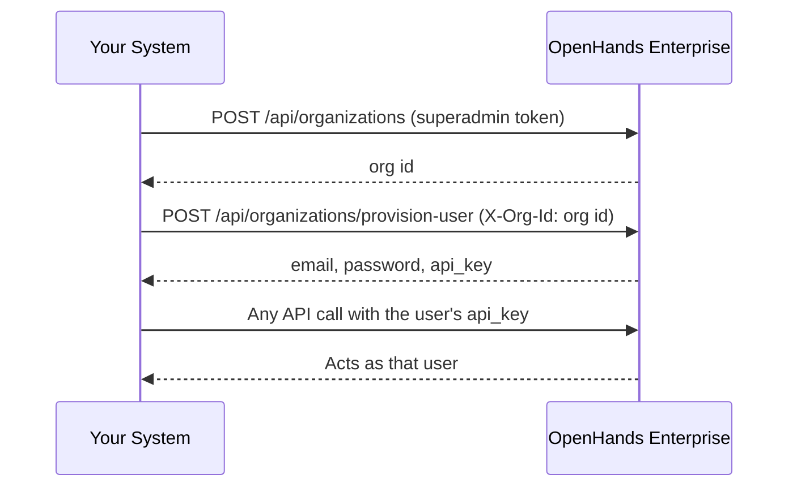

{/* GENERATED from OpenHands/enterprise-cookbook@main (provision-users/README.md). Edit the source, not this file. */}

<Card title="View source on GitHub" icon="github" href="https://github.com/OpenHands/enterprise-cookbook/tree/main/provision-users" horizontal />

Create an [organization](/openhands/usage/cloud/organizations/overview#key-concepts), provision users into it, and get a per-user API key to act on each user's behalf, all as the superadmin of an **OpenHands Enterprise** instance. No UI and no interactive sign-up are involved.

This is the building block for **OEM integrations**, where your own user-management system owns the user and organization lifecycle and mirrors it into OpenHands.

<Note>
  For how personal workspaces, team organizations, and super admins work, see the [Organizations Overview](/openhands/usage/cloud/organizations/overview). For what the VM install and Kubernetes (Helm) settings do, see [Configuring Organizations](/openhands/usage/cloud/organizations/configuring-organizations).
</Note>

<Info>
  This example is **Enterprise-only**. The endpoints do not exist on OpenHands Cloud or the open-source build. The provisioning endpoint is also **off by default**, so an operator must enable it (see [Enabling the Feature](#enabling-the-feature)).
</Info>

## How It Works

Every call is made as the superadmin. The `api_key` that comes back is what your system stores and uses afterwards.



1. `POST /api/organizations` creates the org. Only a superadmin can do this, and the creator is **not** added as a member.
2. `POST /api/organizations/provision-user` creates a user in that org. The target org goes in the **`X-Org-Id` header**, and the call bypasses email verification, terms of service, and OAuth.
3. Use the returned `api_key` as a Bearer token to act on that user's behalf.

The provision-user response holds the new user's `email`, a `password` (generated if you did not supply one, and returned only on a true create), and an `api_key` bound to the target org.

### Idempotency

`provision-user` is idempotent. Re-running it for an email that already exists does not fail or duplicate the account. The server skips the create steps, ensures org membership, and resolves an API key. The `action` field and the HTTP status tell you which branch it took:

| `action`        | HTTP | Meaning                                                                     | `password` |
| --------------- | ---- | --------------------------------------------------------------------------- | ---------- |
| `created`       | 201  | Brand-new user created and added to the org                                 | Set        |
| `added_to_org`  | 200  | User already existed and was added to this org                              | `null`     |
| `reprovisioned` | 200  | User already existed and was already a member, so only the key was resolved | `null`     |

The existing Keycloak password is never rotated, so `password` is `null` on both idempotent paths. By default the endpoint returns the user's **existing** API key. Pass `reissue_api_key: true` (or `--reissue-api-key` on the script) to delete the old key and mint a fresh one. Use this to recover a user who lost their key.

## Prerequisites

- An OpenHands Enterprise instance with user provisioning enabled (see [Enabling the Feature](#enabling-the-feature)).
- The **superadmin** bearer token for that instance. On a fresh install, the superadmin is the first user to authenticate.
- `pip install requests`

<Note>
  A superadmin can list its peers with `GET /api/admin/super-admins`. That endpoint requires superadmin, unless user provisioning is enabled on OHE 1.62.0 or later, when any signed-in user can call it. There is no self-service "am I the superadmin?" endpoint. The [`org-admin`](/cookbook/org-admin) example shows how to find the superadmin and grant the role to more users. For what the role is and is not, see [Super Admins](/openhands/usage/cloud/organizations/overview#super-admins).
</Note>

## Run It

Run these from the `provision-users/` directory.

```bash
pip install requests

export OH_API_BASE=https://openhands.example.com
export OH_API_KEY=$SUPERADMIN_TOKEN

python provision_users.py
```

With no other arguments the script runs a complete demo. It creates a throwaway org and one user, verifies the user's key with `GET /api/organizations/{org_id}/me`, then deletes both again.

```text
created org: Provision Users Demo 24bafb4f (0b624e33-8582-4086-8af9-dfa56f215c2d)

provisioned demo-user-24bafb4f@example.com as member: action=created (HTTP 201)
{
  "email": "demo-user-24bafb4f@example.com",
  "password": "****3lK8",
  "api_key": "****BERX",
  ...
}
  api_key verified -> role=member in org 0b624e33-8582-4086-8af9-dfa56f215c2d

deleted org 0b624e33-8582-4086-8af9-dfa56f215c2d
deleted user demo-user-24bafb4f@example.com
deleted user cleanup-24bafb4f@example.com
```

The password and API key are masked in the output. Pass `--show-secrets` to print them in full.

<Note>
  A superadmin has no org-scoped powers, so deleting an org needs the key of an org **owner**. When none of the demo users is an owner, the script provisions a short-lived `cleanup-…@example.com` owner for that step and deletes it with the others.
</Note>

To provision real users, name the org or the users. The script then keeps everything it creates.

<Tabs>
  <Tab title="New Org">
    ```bash
    python provision_users.py \
      --org-name "Acme Corp" \
      --contact-name "Ada Lovelace" --contact-email ada@example.com \
      --user alice@example.com --user bob@example.com \
      --role member
    ```
  </Tab>

  <Tab title="Existing Org">
    ```bash
    python provision_users.py \
      --org-id 0f9c3b2a-1d4e-4c8a-9b6f-2e7d5a1c3b4d \
      --user carol@example.com --role admin
    ```
  </Tab>

  <Tab title="Recover a Lost Key">
    ```bash
    python provision_users.py \
      --org-id 0f9c3b2a-1d4e-4c8a-9b6f-2e7d5a1c3b4d \
      --user carol@example.com --reissue-api-key
    ```
  </Tab>
</Tabs>

| Flag                                | Environment variable | Default                                               |
| ----------------------------------- | -------------------- | ----------------------------------------------------- |
| `--api-key`                         | `OH_API_KEY`         | Required (superadmin token)                           |
| `--base-url`                        | `OH_API_BASE`        | Required (an Enterprise instance has no standard URL) |
| `--org-name`                        |                      | A generated demo name                                 |
| `--org-id`                          |                      | Create a new org                                      |
| `--contact-name`, `--contact-email` |                      | Demo values, used when creating an org                |
| `--user`                            |                      | One generated demo user. Repeat for several           |
| `--role`                            |                      | `member` (or `admin`, `owner`)                        |
| `--reissue-api-key`                 |                      | Off                                                   |
| `--keep`                            |                      | Off. In demo mode, leave the org and user in place    |
| `--show-secrets`                    |                      | Off                                                   |

## The Two Calls That Matter

Create the org. The superadmin is **not** added as a member:

```python
requests.post(
    f"{base_url}/api/organizations",
    headers={"Authorization": f"Bearer {admin_token}"},
    json={
        "name": "Acme Corp",
        "contact_name": "Ada Lovelace",
        "contact_email": "ada@example.com",
    },
)
# -> { "id": "<org-id>", "name": "Acme Corp", ... }
```

Provision a user into it. The target org travels in the `X-Org-Id` header, not the URL:

```python
requests.post(
    f"{base_url}/api/organizations/provision-user",
    headers={
        "Authorization": f"Bearer {admin_token}",
        "X-Org-Id": org_id,
    },
    json={"email": "new-user@example.com", "role": "member"},
)
# 201 Created ->
#   { "email": "...", "password": "...", "api_key": "sk-...",
#     "user_id": "...", "org_id": "...", "role": "member",
#     "created": true, "action": "created" }
```

`role` is one of `member` (default), `admin`, or `owner`. You can also pass an optional `password` (it must satisfy the realm policy), `api_key_name`, and `reissue_api_key`.

## Enabling the Feature

The endpoint is registered only when the operator turns it on. Both install types set `USER_PROVISIONING_ENABLED=true` on the app server:

| Install type      | Where                                     | Setting                                                                                  |
| ----------------- | ----------------------------------------- | ---------------------------------------------------------------------------------------- |
| VM install        | Admin console → Config → Advanced Options | Check **Enable OEM User Creation Flow**, then save the config and deploy the new version |
| Kubernetes (Helm) | Your `values.yaml`                        | `userProvisioning.enabled: true`                                                         |


When it is disabled, `POST /api/organizations/provision-user` returns `404`. Org creation and superadmin management are always available.

For what this setting does across the installation, see [User Provisioning](/openhands/usage/cloud/organizations/configuring-organizations#user-provisioning).

## Troubleshooting

<Accordion title="401 Invalid service API key">
  You are calling the wrong endpoint. That error comes from the internal service-to-service routes under `/api/service/*`, such as `POST /api/service/users/{user_id}/orgs/{org_id}/api-keys`. They authenticate with the `X-Service-API-Key` header, checked against the operator-provisioned `AUTOMATIONS_SERVICE_KEY` shared secret. That key is meant for the internal automations service, not for admins.

  User provisioning is a different flow. Call `POST /api/organizations/provision-user` with an `Authorization: Bearer <superadmin-token>` header and `X-Org-Id`. It never uses `X-Service-API-Key`. `X-Session-API-Key` (per-sandbox agent-server auth, used in other examples) is also distinct from the plain Bearer token this endpoint expects.
</Accordion>

<Accordion title="404 Not Found on provision-user">
  The feature is disabled. See [Enabling the Feature](#enabling-the-feature).
</Accordion>

<Accordion title="403 Forbidden">
  The caller lacks the `PROVISION_USER` permission (org `owner` or `admin`, or an instance super role), or you targeted a personal workspace. Provisioning into a personal workspace is rejected.
</Accordion>

## Security

<Warning>
  The provision-user response is a secret. The `password` is returned only there, because the endpoint bypasses the email-based set-password flow, and the `api_key` grants access as the new user. Do not log the response, hand the credential to the user out-of-band, and always use TLS. The script masks both values unless you pass `--show-secrets`.
</Warning>

- **Guard the superadmin token.** Anyone holding it can create orgs, mint users, and grant or revoke superadmin. Treat it like a root credential.
- A superadmin does **not** inherit org-scoped powers (secrets, billing, LLM settings, org deletion) in the orgs it creates. See [Super Admins](/openhands/usage/cloud/organizations/overview#super-admins).

## APIs Used

| Endpoint                                 | Used for                                         |
| ---------------------------------------- | ------------------------------------------------ |
| `POST /api/organizations`                | Create the org (superadmin only)                 |
| `POST /api/organizations/provision-user` | Create or re-provision a user and get an API key |
| `GET /api/organizations/{org_id}/me`     | Verify the minted key and its role               |
| `DELETE /api/organizations/{org_id}`     | Demo cleanup: delete the org, as an org owner    |
| `DELETE /api/admin/users/{user_id}`      | Demo cleanup: delete a user, as the superadmin   |

## Related

<CardGroup cols={2}>
  <Card title="Organizations Overview" href="/openhands/usage/cloud/organizations/overview" icon="book-open">
    Personal workspaces and team organizations, the current organization, super admins, and the default organization
  </Card>

  <Card title="Configuring Organizations" href="/openhands/usage/cloud/organizations/configuring-organizations" icon="book-open">
    What the VM install and Kubernetes (Helm) settings do, and how to migrate an existing installation
  </Card>

  <Card title="org-admin" href="/cookbook/org-admin" icon="user-shield">
    Find the super admin and create team orgs before you provision users into them
  </Card>

  <Card title="service-account-github-pat" href="/cookbook/service-account-github-pat" icon="id-card">
    Act for many users from one account with per-conversation credentials
  </Card>

  <Card title="per-conversation-secrets" href="/cookbook/per-conversation-secrets" icon="user-secret">
    Inject secrets into a single conversation
  </Card>

  <Card title="User provisioning endpoint (OpenHands #14864)" href="https://github.com/OpenHands/OpenHands/pull/14864" icon="arrow-up-right-from-square">
    The provisioning endpoint
  </Card>

  <Card title="Super roles (OpenHands #14937)" href="https://github.com/OpenHands/OpenHands/pull/14937" icon="arrow-up-right-from-square">
    Instance-level superadmin roles
  </Card>

  <Card title="Idempotent re-provisioning (enterprise #117)" href="https://github.com/OpenHands/enterprise/pull/117" icon="arrow-up-right-from-square">
    reissue_api_key, action, and 200 vs 201
  </Card>
</CardGroup>
