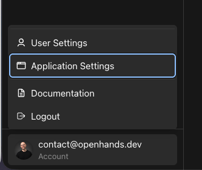

{/* Suggest Tasks on GitHub and Enable Solvability Analysis also appear on this page but are not documented:
   neither switch saves a value from this page (OpenHands/enterprise@fb2fa89). Document them once they work. */}

Use Application Settings to set your interface language, sound notifications, how new conversations use sandboxes,
and the Git identity that OpenHands uses for commits. These settings belong to your user account and apply in every
organization you belong to. Every organization role can change them.

To open Application Settings, click your account at the bottom of the left sidebar, then select
`Application Settings`. After you change a setting, click `Save Changes`.

<Frame>
  
</Frame>

## Language

Choose the interface language from the `Language` dropdown. The language changes the OpenHands interface only. It
doesn't change the language the agent uses.

| Language | Code |
| --- | --- |
| English | `en` |
| 日本語 | `ja` |
| 简体中文 | `zh-CN` |
| 繁體中文 | `zh-TW` |
| 한국어 | `ko-KR` |
| Norsk | `no` |
| Arabic | `ar` |
| Deutsch | `de` |
| Français | `fr` |
| Italiano | `it` |
| Português | `pt` |
| Español | `es` |
| Català | `ca` |
| Türkçe | `tr` |
| Українська | `uk` |

## Sound Notifications

Turn on `Sound Notifications` to play a sound when the agent finishes, needs your input, or is waiting for you to
confirm an action. Sound notifications are off by default.

## Sandbox Grouping Strategy

`Sandbox Grouping Strategy` controls whether a new conversation starts its own sandbox or joins one of your running
sandboxes in the current organization.

| Option | Behavior |
| --- | --- |
| No Grouping | Start a new sandbox for each conversation. |
| Group by Newest | Add the conversation to your most recent sandbox. |
| Least Recently Used | Add the conversation to your oldest sandbox. |
| Fewest Conversations | Add the conversation to the sandbox with the fewest conversations. |
| Add to Any | Add the conversation to the first available sandbox. |

If you don't have a saved strategy, OpenHands uses your deployment's default. The supplied Docker Compose
configuration defaults to `Fewest Conversations`. If your deployment has no configured default, OpenHands uses
`No Grouping`.

If you don't have a saved strategy, the dropdown shows `No Grouping`. Saving Application Settings can save that
value as your preference and override the deployment default, even if you only changed another setting.

Grouping skips sandboxes that already hold the maximum number of conversations. Conversations in one sandbox share
its files, credentials, and compute, so a problem in one conversation can affect the others. For placement through
the API, see [Conversations and Sandboxes](/enterprise/conversations-and-sandboxes).

## Default Sandbox

`Default Sandbox` chooses the sandbox specification for new sandboxes. The list shows the specifications available
on your installation, including any [custom sandbox images](/enterprise/custom-sandbox-images/using-custom-images)
that administrators add. Leave it at `System default` unless you need a specific one. If the specification you
choose is removed, OpenHands uses the system default.

## Git Settings

### Repository Cloning

OpenHands clones repositories with a shallow history by default, which starts faster for large repositories. Turn on
`Fetch full Git history for repositories` when your tasks need full history, such as tags, merge bases, blame, or
older commits.

### Git Author

By default, OpenHands commits as `openhands` with the email `openhands@all-hands.dev`. To commit as yourself, enter a
`Git Username` and `Git Email`. The agent adds OpenHands as a co-author on its commits.

### GPG Key

To sign commits, click `Set GPG Key` and paste an ASCII-armored GPG private key without a passphrase. OpenHands saves
it as a secret named `GPG_KEY` right away, without `Save Changes`. Setting a new key replaces the existing one. See
[Secrets Management](/enterprise/secrets-management).

## About

The `About` section at the bottom of the page shows your OpenHands Enterprise release, the app server and Agent SDK
versions, and your license status and type. Click `Copy version info` to copy them, for example when you contact
support. To update your license, see [Configure License Key](/enterprise/license).
