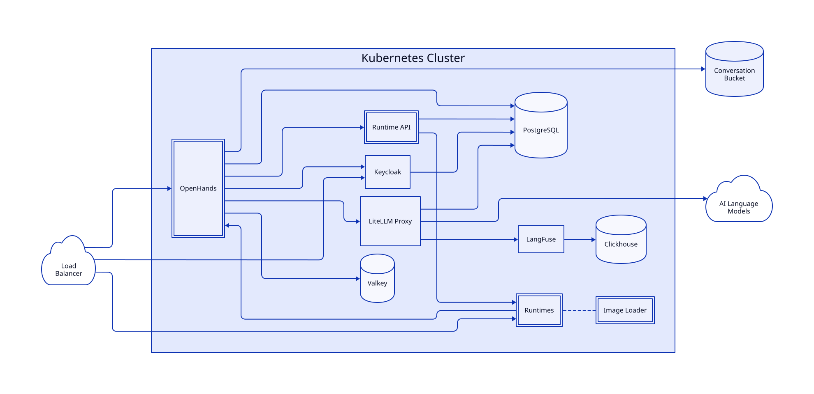

OpenHands Enterprise can be deployed into an existing Kubernetes cluster using Helm.
This approach gives you full control over the deployment and is ideal for teams with
Kubernetes expertise who want to integrate OpenHands into their existing infrastructure.

<Note>
  If you prefer a simpler installation, see the [Quick Start](/enterprise/quick-start)
  guide for VM-based deployment.
</Note>

## Start Here

1. [Get an Enterprise license](/enterprise/k8s-install/installation#get-an-enterprise-license).
   Request a license enabled for Helm installations and obtain its registry
   credentials from the install portal or our team. Existing trial users must
   also confirm Helm access with our team.
2. Review the [installation prerequisites](/enterprise/k8s-install/installation#prerequisites),
   then prepare your cluster using the [Amazon EKS](/enterprise/k8s-install/eks),
   [Azure AKS](/enterprise/k8s-install/aks), or
   [Google GKE](/enterprise/k8s-install/gke) guide. These pages cover the
   provider-specific infrastructure and Helm values.
3. Return to [Install with Helm](/enterprise/k8s-install/installation#step-1-log-in-to-the-registry)
   to log in to the registry, configure and install OpenHands, and validate your first
   conversation. Apply the provider-specific values from your cluster guide.

## When to Use This Approach

Choose the Kubernetes installation path when you:

- Have an existing Kubernetes cluster you want to deploy into
- Need fine-grained control over resource allocation and scaling
- Want to integrate with existing infrastructure (external PostgreSQL, Redis, S3)
- Have a platform team familiar with Helm and Kubernetes operations
- Need to comply with specific infrastructure policies or constraints

## Architecture Overview

OpenHands Enterprise consists of several components deployed as Kubernetes workloads:

### Core Components

| Component | Description |
|-----------|-------------|
| **OpenHands Server** | Main application server handling UI, API, and agent orchestration |
| **Runtime API** | Manages sandbox lifecycle: provisioning, scaling, and cleanup |
| **Runtimes (Sandboxes)** | Isolated containers where agents execute code |
| **Keycloak** | Identity and access management |
| **LiteLLM Proxy** | Routes requests to your LLM provider(s) |
| **PostgreSQL** | Persistent storage for application data |
| **Redis** | Caching and session management |

### Supporting Services

| Component | Description |
|-----------|-------------|
| **Conversation Bucket** | S3-compatible storage for conversation history |
| **Image Loader** | Optional standalone Helm chart that pre-loads the runtime (agent-server) image on sandbox nodes; not installed by the `openhands` chart or the Replicated installer |

## Guides

<Card title="Sizing Guide" icon="ruler" href="/enterprise/sizing-guide">
  Size your node pools, volume storage, and database from peak concurrent sandboxes.
</Card>

<Card title="Install with Helm" icon="ship" href="/enterprise/k8s-install/installation">
  End-to-end installation instructions using your OpenHands Enterprise license.
</Card>

<Card title="Installing Sysbox" icon="cube" href="/enterprise/k8s-install/sysbox">
  Install the Sysbox runtime so agent sandboxes can run securely.
</Card>

<Card title="DNS and TLS" icon="lock" href="/enterprise/k8s-install/dns-and-tls">
  Automate DNS records and TLS certificates with external-dns and cert-manager.
</Card>

<Card title="Amazon EKS" icon="aws" href="/enterprise/k8s-install/eks">
  Prepare an Amazon EKS cluster to run OpenHands Enterprise.
</Card>

<Card title="Azure AKS" icon="/enterprise/images/azure-logo.svg" href="/enterprise/k8s-install/aks">
  Prepare an Azure Kubernetes Service cluster to run OpenHands Enterprise.
</Card>

<Card title="Google GKE" icon="google" href="/enterprise/k8s-install/gke">
  Prepare a Google Kubernetes Engine cluster to run OpenHands Enterprise.
</Card>

<Card title="External PostgreSQL" icon="database" href="/enterprise/external-postgres">
  Configure OpenHands to use your own PostgreSQL database instead of the bundled instance.
</Card>

<Card title="Resource Limits" icon="gauge-high" href="/enterprise/k8s-install/resource-limits">
  Configure memory, CPU, and storage for optimal performance.
</Card>

<Card title="Upgrade Guidance" icon="circle-up" href="/enterprise/k8s-install/upgrade-guidance">
  Generic advice for upgrading the Kubernetes cluster underneath OpenHands.
</Card>

## Request Access

Kubernetes-based installation is currently available to select customers on request.
If you're interested in deploying OpenHands Enterprise into your own Kubernetes cluster,
please contact our team to discuss your requirements.

<Card title="Contact Sales" icon="envelope" href="https://openhands.dev/contact">
  Get in touch with our team to request access to Kubernetes installation.
</Card>
