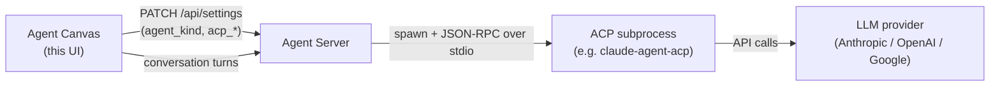

Use this guide when you want to bring Claude Code, Codex, Gemini CLI, Pi, or OpenCode into Agent Canvas. Agent Canvas can drive conversations with the built-in **OpenHands** agent or with an external **ACP agent**. For an ACP agent, the selected backend launches the provider's CLI and must have access to its subscription login or API key.

## What is an ACP agent?

The [Agent Client Protocol (ACP)](https://agentclientprotocol.com/protocol/overview) is a standard for talking to coding agents over JSON-RPC on stdio. Instead of Agent Canvas calling an LLM directly, the Agent Server spawns the agent's own CLI as a subprocess and relays each turn to it. The external agent manages its own LLM, tools, and execution; Agent Canvas sends messages and renders what comes back.

The Agent Server owns the subprocess and the credentials; Agent Canvas only records *which* agent to run and surfaces a form for the secrets it needs. The agent choice is stored per backend, so switching backends can switch agents.

## Supported providers

| Provider | Default command |
|---|---|
| **Claude Code** | `npx -y @agentclientprotocol/claude-agent-acp` |
| **Codex** | `npx -y @zed-industries/codex-acp` |
| **Gemini CLI** | `npx -y @google/gemini-cli --acp` |
| **Pi** | `npx -y --package=pi-acp --package=@earendil-works/pi-coding-agent pi-acp` |
| **OpenCode** | `npx -y opencode-ai acp` |

Pi and OpenCode are offered on **local** backends only — your machine or a self-hosted Agent Server, including Docker. OpenHands Cloud runs only Claude Code, Codex, and Gemini CLI, so Canvas hides the other two there. Neither Pi nor OpenCode is pre-installed in the Agent Server image, so the first conversation downloads the CLI through `npx`.

The provider list is sourced from the OpenHands SDK registry (`openhands.sdk.settings.acp_providers`, mirrored into `@openhands/typescript-client`) and enriched with Canvas UI metadata. Adding or changing a provider happens upstream in the SDK.

## Authentication

<Info>
  ACP agents authenticate **two ways: a subscription login, or an API key** — and the onboarding fields are optional. If you're already signed in to the provider's CLI on the machine the agent runs on, it reuses that login automatically, so locally you often don't need a key at all. **The login takes priority over an API key:** while you're signed in, a key set in the environment isn't used — so the onboarding key fields do nothing and can be left blank.
</Info>

A "subscription login" is the credential the provider's own CLI stores when you sign in once — a file in your home directory, or, for Claude Code on macOS, the system **Keychain**. When the Agent Server runs **on that same machine** (a local or self-hosted backend), the provider CLI finds that login automatically — no API key required. On a clean cloud sandbox there's no stored login, so an API key is needed instead.

| Provider | Subscription login (auto-detected) | API key |
|---|---|---|
| **Claude Code** | A Claude Code login (Pro/Max), from Claude Code's own credential store: the **macOS Keychain**, or `~/.claude/.credentials.json` on Linux | `ANTHROPIC_API_KEY` |
| **Codex** | A ChatGPT login (`codex login`) cached at `~/.codex/auth.json` | `OPENAI_API_KEY` |
| **Gemini CLI** | Your Google login (`gemini`/`gemini --acp`) cached at `~/.gemini/oauth_creds.json` | `GEMINI_API_KEY` |
| **Pi** | Any login or key saved by `pi` (`/login`) in `~/.pi/agent/auth.json` (or `$PI_CODING_AGENT_DIR`) | `ANTHROPIC_API_KEY` |
| **OpenCode** | Provider logins saved by `opencode auth login` in `~/.local/share/opencode/auth.json` | `OPENCODE_API_KEY` |

Each provider collects an *optional* API key in onboarding (plus a base URL where the provider honors one — Pi and OpenCode do not). As noted above, a subscription / OAuth login takes priority over an API key — when the provider's CLI is signed in, a key set in the environment is not used:

- **Codex** — `codex login status` keeps reporting the ChatGPT login even with `OPENAI_API_KEY` set.
- **Gemini CLI** — uses the OAuth auth type chosen at `gemini` login; `GEMINI_API_KEY` is only consulted if you switch the auth type. The free Google login is the common no-key path locally — sign in once and it just works.
- **Claude Code** — with both present, `claude auth status` reports it is authenticated via the subscription (`claude.ai`), not the key. The login is auto-detected from the macOS Keychain (or `~/.claude/.credentials.json` on Linux); `CLAUDE_CONFIG_DIR` is **not** required for it — it only relocates Claude Code's config directory (settings/history, not the token) and signals the SDK to strip a conflicting `ANTHROPIC_API_KEY` / `ANTHROPIC_BASE_URL`.

Two providers behave differently:

- **Pi** needs *some* credential: with none, the session fails with `Authentication required`. Pi picks its model from whichever provider that credential unlocks, so Canvas does not preselect one. To route Pi through a proxy, declare the provider in Pi's own `models.json`; `ANTHROPIC_BASE_URL` is ignored. Pi's key is the same `ANTHROPIC_API_KEY` secret Claude Code reads, and Claude Code then uses it instead of your Claude login.
- **OpenCode** runs without any credential on OpenCode Zen's free models (including its default, `opencode/big-pickle`), so its credential step never blocks onboarding. A key or login unlocks the paid models.

The one exception is the **base URL** (`*_BASE_URL`): a custom value points the CLI at a different endpoint (a proxy or gateway) and *does* take effect even under a login — for Gemini it rides the ACP `gateway` param. It's an advanced override, not needed for normal use.

## Onboarding an ACP agent

First-time users get a four-step onboarding modal. To onboard an ACP agent:

1. **Choose agent** — pick Claude Code, Codex, Gemini CLI, Pi, or OpenCode instead of OpenHands. The choice is saved immediately to your backend's settings.
2. **Check backend** — confirms Agent Canvas can reach the Agent Server.
3. **Set up credentials** — enter the provider's credentials. Beyond the API key (and, where the provider honors one, an optional base URL), this step also collects the credentials a *containerized* backend needs, since a fresh container has no host login:
   - **Codex** — `CODEX_AUTH_JSON` (the contents of `~/.codex/auth.json`).
   - **Claude Code** — `CLAUDE_CODE_OAUTH_TOKEN` (a Pro/Max OAuth token).
   - **Gemini CLI** — `GOOGLE_APPLICATION_CREDENTIALS_JSON` (Vertex SA / ADC JSON) plus `GOOGLE_CLOUD_PROJECT`, `GOOGLE_CLOUD_LOCATION`, and `GOOGLE_GENAI_USE_VERTEXAI`.
   - **Pi** — `PI_AUTH_JSON` (the contents of `~/.pi/agent/auth.json`).
   - **OpenCode** — `OPENCODE_AUTH_CONTENT` (the contents of `~/.local/share/opencode/auth.json`).
4. **Say hello** — creates your first conversation and closes the modal.

<Note>
  Every credential field is optional and the step is skippable. Leave a field blank to reuse a key already set on the backend, or to authenticate the agent through a subscription / OAuth login instead.
</Note>

### How credentials reach the agent

Each credential you enter is saved as a **global secret** whose name is exactly the environment variable the Agent Server exports into the ACP subprocess (e.g. `ANTHROPIC_API_KEY`). Saving in onboarding is identical to adding the secret under **Settings → Secrets**, where you can edit or remove it anytime. Keeping the secret name equal to the env var is what makes a saved key actually reach the provider CLI.

### Run ACP agents in a container

The walkthrough above assumes the Agent Server runs on your own machine, where the provider CLIs reuse a host login. You can also run the Agent Server **in a container**. Canvas drives it the same way, but since a fresh container has no host login, you supply credentials through the UI and Canvas sends them inline on the conversation start request.

In onboarding's **Set up credentials** step, the credentials you enter are saved as global secrets in the agent-server's secret store (as usual). The start request then references each as a lookup secret, and the agent-server resolves the value back from its own store at spawn time. On a **local** backend the step stays optional (a host login is reused automatically); on a **Docker** or cloud backend it is required, because there is no host login to fall back on. When the login probe detects an existing session, the step shows a "you're already signed in" banner and stays skippable. OpenCode's step is always skippable, since it can run on free models without a credential.

## Switching agent or model later

Open **Settings → Agent** at any time:

- **Agent** — switch between **OpenHands** and **ACP**.
- **Preset** — pick a built-in provider (Claude Code, Codex, Gemini CLI, and, on a local backend, Pi or OpenCode) or **Custom** to point at any other ACP server.
- **Command** — the command line used to spawn the subprocess. Selecting a preset fills this in; editing it to match another preset re-detects that provider. API keys are *not* entered here — they live in the Secrets panel.
- **Credentials** — sign in or add the provider's keys. They come before the model because the models a provider offers depend on them.
- **Model** — **Agent default** (the provider picks, saving no model), one of the provider's models, or a custom model ID. Gemini has no **Agent default**; Canvas preselects `gemini-2.5-pro` (see the note in [Run ACP agents in a container](#run-acp-agents-in-a-container)).

Canvas keeps no list of models; the agent reports its own. On a local backend, Canvas asks the agent-server (`POST /api/acp/models`) to start the provider with your saved credentials and report the models it offers and the one it uses by default, so account-dependent catalogs (a ChatGPT plan's Codex models, a Claude subscription's aliases, OpenCode's free tier versus a Zen key) show what you can actually run. The first lookup can take a few seconds while the provider starts; results are cached. If the agent rejects its login, Settings says so instead of showing a stale "signed in" banner.

Cloud can't ask before a conversation starts, so until then the model field offers **Agent default** and a custom model ID. Each conversation's session reports its models, which the in-chat picker offers for switching mid-conversation; Canvas remembers the last list per backend, provider, and secret scope in the browser and offers it in Settings and on the home page from then on, only to profiles that allow the same secrets (also the fallback for older agent-servers and failed lookups).

Saving writes an `agent_settings_diff` (`agent_kind`, `acp_server`, `acp_command`, `acp_model`) to `PATCH /api/settings`. A running conversation keeps the agent it started with; the new choice applies to conversations you start afterward.

## Custom ACP servers

Any stdio ACP server works: choose **Custom** in Settings → Agent and enter its launch command. Canvas can't ask a custom server for its models before a conversation, so enter the model ID the server expects (if any) as a custom model; inside a conversation the picker lists what the session reports. Pass credentials by adding the env vars the server reads as global secrets under **Settings → Secrets**.

## Related Guides

- [Customize and Settings](/openhands/usage/agent-canvas/customize-and-settings)
- [Manage LLM Profiles](/openhands/usage/agent-canvas/llm-profiles)
- [Connect and Manage Backends](/openhands/usage/agent-canvas/backends)
