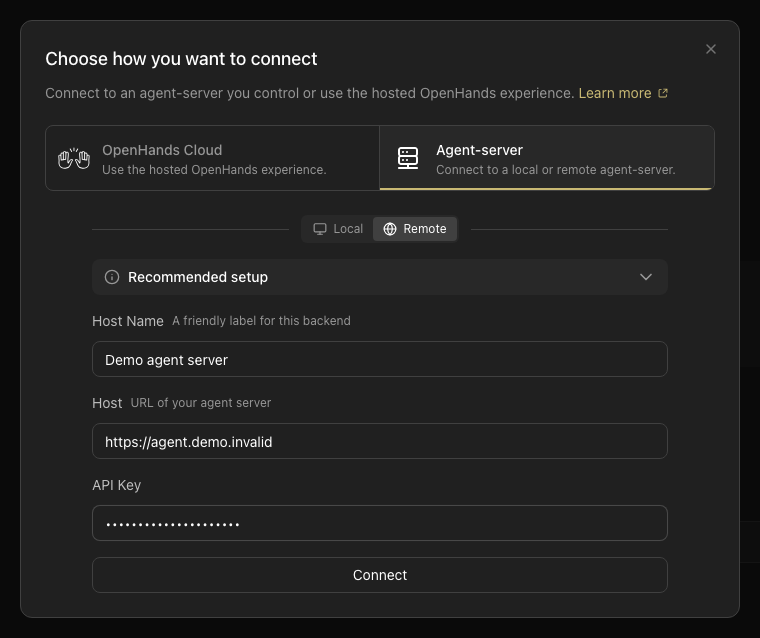

A **backend** provides [Agent Server](/sdk/guides/agent-server/overview#what-is-a-remote-agent-server) and, when automations are enabled, Automation Server. Agent Server runs conversations and tools in a workspace: the folder, mounted project directory, container, or cloud sandbox where the agent reads and writes files. Automation Server manages schedules, events, and run lifecycle. Agent Canvas connects to these services and displays the state of whichever backend is selected.

## Connecting to a Backend

On the home launcher, Agent Canvas remembers the repository and branch you last picked for each cloud backend. The remembered selection is validated in the background; a selection that can no longer be used is dropped silently, and a clear control removes the current one. The selection is stored per backend.

Any Agent Canvas frontend can connect to any Agent Canvas backend. Use the backend switcher in the UI to open **Manage Backends**, where you can add, edit, or remove entries. Each entry stores a display name, host URL, and an API key for authentication.

Settings, LLM configuration, MCP servers, and automations are all scoped to the active backend — switching backends switches all of these.

"Remote" describes how Canvas connects to a backend, not where that backend runs. A remote backend can be a separate process on the same machine, a self-hosted deployment on a VM or container platform, or a managed Cloud or Enterprise service.

## Recommended Setups

<CardGroup cols={2}>
  <Card title="Default local" icon="laptop" href="/openhands/usage/agent-canvas/backend-setup/local">
    Use for quick local work on your machine. Run `agent-canvas` and a local backend is created
    automatically.
  </Card>
  <Card title="Remote backend" icon="tower-broadcast" href="/openhands/usage/agent-canvas/backend-setup/remote">
    Use for a separate local process or container. Deploy the backend services, then add their host
    URL and API key in `Manage Backends`.
  </Card>
  <Card title="VM / self-hosted" icon="server" href="/openhands/usage/agent-canvas/backend-setup/vm">
    Use for an always-on backend, more powerful hardware, or team-shared access.
  </Card>
  <Card title="Cloud or Enterprise" icon="cloud" href="/openhands/usage/agent-canvas/backend-setup/cloud">
    Use for managed backend and sandbox infrastructure. Connect from `Manage Backends`.
  </Card>
  <Card title="DigitalOcean Managed Agents" icon="digital-ocean" href="/openhands/usage/agent-canvas/backend-setup/digitalocean">
    Use for on-demand, isolated cloud sandboxes that pause when idle.
  </Card>
</CardGroup>

## DigitalOcean Managed Agents

The **Providers** tab in **Add Backend** connects Agent Canvas to [DigitalOcean Managed Agents](/openhands/usage/agent-canvas/backend-setup/digitalocean). Sign in with a DigitalOcean personal access token, then create or open an OpenHands agent. Each session of that agent runs in its own DigitalOcean sandbox and appears in Agent Canvas as a separate backend.

The Providers tab is available in the desktop app, and in the web build when its server sets `MARS_WEB=1`.

<Note>
  Removing a DigitalOcean backend from `Manage Backends` offers **Disconnect only**, which leaves the session running and billing until it pauses, or **Stop session**, which deletes its sandbox. See [Disconnecting vs. Stopping](/openhands/usage/agent-canvas/backend-setup/digitalocean#disconnecting-vs-stopping).
</Note>
