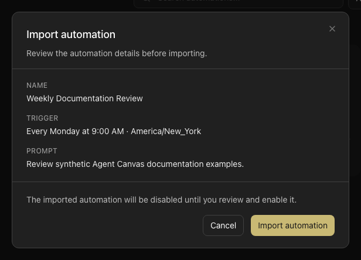

The **Automate** view in Agent Canvas is the in-app control center for your automations. From here you can see all automations on the active backend, inspect their configuration and run history, and manage their lifecycle without leaving the app.

<Note>
  Automations run on the active backend. Switch backends from [Connect and Manage Backends](/openhands/usage/agent-canvas/backends) to see automations on a different backend.
</Note>

## Browse and inspect automations

Open the **Automate** tab in the sidebar to see all automations on the active backend. Each row shows the automation name, trigger type, and enabled state. When the active backend is healthy but has no automations, the Automate pane remains available and includes an option to add one.

Click an automation to open its detail view. The detail view shows:

- An explanation of what the automation does: its own description, or the description from its catalog template when available. If neither is available, a generated `How it runs` flow summarizes its trigger and action. A template description also includes the template's diagram when the published catalog supplies one; otherwise it includes a generated flow.
- The full prompt the automation runs
- The automation's script, for automations that run a script bundle instead of a prompt (bundle file rows start collapsed; open a row to read it)
- Trigger configuration (schedule, webhook, or event)
- LLM profile used for runs
- The automation's tags, when it has any
- Recent run history and status

### Tags

An automation can carry tags, which appear as pills on list rows, cards, the detail view, and pinned Home cards. Use the **Tag** filter on the dashboard to narrow the list to automations with a given tag.

Tags are declared by the automation and served by the automation service. On a cloud-backed organization, the person an automation runs as can edit its tags. For an automation that runs as a service account, editing tags requires `manage_automations` permission; its recorded creator alone cannot edit them. Tags are edited inline. Tag names are normalized: spaces become hyphens and letters are lowercased, so `Software Factory` is stored as `software-factory`. See [Enterprise Automations](/enterprise/automations#who-can-manage-automations) for the corresponding edit rules.

Tag support requires automation `1.26.0` and the optional `/v1/tags` endpoint. Without them, the tag UI is not shown.

### Run Statuses

A run can be `PENDING`, `RUNNING`, `COMPLETED`, `FAILED`, `CANCELLED`, or `SKIPPED`. A `SKIPPED` run can occur when the backend reaches its concurrency limit. Future backend statuses appear as a neutral status badge so they do not prevent you from viewing the automation.

A completed run's badge also reflects its task outcome. When the finish response has no task outcome status, the run shows a successful badge. Only an explicit unrecognized status string maps to **Needs review**. When the finish response carries an `outcome_summary` without a status, the run still shows that summary. These display rules are the same in the Activity Log, the run logs, the home health metrics, and automation insights.

### Run Phase

Automation runs surface a live **phase** that reflects a run's current state: `PENDING`, `RUNNING`, or `FAILED`. The phase appears on automation cards, in the Activity Log, and on the home screen, and updates live as a run progresses. The phase text is supplied by the automation service and can be a short descriptive string, such as "Agent is working on the task". A failed run retains its last phase after it stops.

### Shared Automation Conversations on Cloud

On OpenHands Cloud, a run's conversation can be viewed read-only by other members of your organization. Open the run's link — from the Activity Log or a `/conversations/<id>` URL — and, if you are not the owner, Agent Canvas renders the conversation in read-only mode instead of reporting that it does not exist. Read-only viewers can follow the conversation history but cannot send messages or change the automation.

### Script Automation Run Logs

An automation that runs a script bundle executes its entrypoint directly instead of starting a conversation. For these runs, the run record has no conversation. Use **View logs** on the run to read the script's output; Agent Canvas resolves the logs from the run's sandbox on cloud backends. A run that executed a script shows `No conversation — this run executed a script. Use View logs for its output.` instead of `No Conversation`.

<Note>
  On cloud backends, a run's sandbox is deleted shortly after the run finishes unless the backend keeps it for a cleanup delay. Once the sandbox is gone, the logs are no longer available and the run shows a deleted-sandbox message. Open **View logs** while the run is in progress to read its output.
</Note>

To see what a script automation runs, open its detail view and read the **Script** section, which replaces the prompt section for prompt-less automations and lists the bundle's files.

### Activity Log Costs and Exports

The Activity Log displays a completed run's reported LLM cost in USD to four decimal places. A measured zero cost appears as `$0.0000`; when the backend does not report a cost, no cost appears in the log.

Use the Activity Log export controls to download run data as CSV or JSON. Both formats include a raw numeric `cost` field for every run, as well as the run's `phase`. An unavailable cost is exported as `null`.

## Create an automation with the setup assistant

Creating an automation opens a split view: a setup form on one side and a conversation with OpenHands on the other. You can describe the automation in the conversation and let OpenHands fill the form for you, or fill the fields yourself.

- A form section shows when OpenHands filled it, and agent-filled field labels display a compact **✦**. Editing a field yourself clears the marker so you can see what you changed.
- The assistant proposes settings in the form for you to review. It does not create or enable the automation directly through the API while you are setting it up.
- The form covers the same settings as any automation: name, prompt, trigger, schedule, model, repository, and plugins. Event-source and event-key suggestions come from the deployment's reported capabilities; if these are unavailable, ask which integration delivers the event rather than assuming a source exists.

The setup view is a **draft** until you create the automation. Drafts are saved and persist across reloads, including on cloud-backed deployments:

- Reopen a draft from **Automate** → **Edit** to continue where you left off. The setup conversation is restored and pre-populates the form.
- The conversation that backs a draft is created only when you need it, so drafting does not start a run on its own.
- Test a draft before creating it, and review its test runs, from the draft's row in **Automate** without opening a new conversation.
- Create the final automation when the form looks right; it then appears in the automation list like any other.

For an automation that runs a script bundle, the setup view also includes the LLM profile pill, and a new custom-script automation saves the chosen model.

To reach the setup flow from the home page, use the splash-page mode toggle to switch into automation mode and open the automation entry point.

### Repository picker providers

The Repositories picker in the setup form lists repositories from every connected provider whose repositories automation runs can clone. With more than one provider connected, a Git provider choice at the top of the list switches between them, with GitHub first. A provider that the automation service cannot clone keeps its **can't clone yet** explanation.

How a picked repository is stored depends on the provider:

- A GitHub repository keeps its `owner/repo` shorthand.
- Other providers' repositories are stored as their URL on the provider's host, such as `https://gitlab.com/group/project`.
- A repository on a connected self-hosted host is sent with its provider, so the run authenticates the clone with that token.
- Azure DevOps repositories are stored as `https://dev.azure.com/org/project/_git/repo`.
- A Bitbucket Data Center repository is stored as its clone URL, `https://<host>/scm/PROJ/repo.git`, and is sent with the `bitbucket_data_center` provider when the service supports cloning it. A personal repository becomes `/scm/~USER/repo.git`. The picker and the automation's cards show the shorter `PROJ/repo` form.

Template setup has a separate repository-picker rule. The bundled Bitbucket Data Center code review and Jira Data Center issue-to-Bitbucket Data Center PR templates offer a Bitbucket Data Center repository picker when the provider is connected and its host is known. Templates can also offer an Azure DevOps picker for a connected provider. Without a connection, or without a known Data Center host, the template can leave a text field instead. Selecting a repository does not by itself mean the automation service will clone it: template preflight and creation include the pick in `repos` only when the service reports cloning support for that provider. Otherwise, the template prompt still names the repository for the agent to handle. Check the deployment's clone-provider capability and event-source support before relying on a Data Center automation.

### Event triggers and event types

An automation with an event trigger runs in response to an event from a connected source. In the setup form, the event-type suggestions follow the selected source rather than always listing GitHub's events:

- **GitHub** — the standard GitHub event list.
- **Jira Data Center** — event types are read from the payload's `webhookEvent` field.
- **Bitbucket Data Center** — event types are read from the payload's `eventKey` field.
- **Azure DevOps** — its own event types.

A source that does not report its own event types keeps GitHub's list for GitHub only.

### Event Sources

An event trigger can also listen to a custom webhook source, such as a CI system or an incident tool. Register these sources in **Automate** → **Events**, which gives each source a webhook URL and a signing secret for the external service. The page appears when the backend's automation service supports it. Anyone who can view automations sees the list, and users who can manage automations can add sources.

See [Event Sources](/openhands/usage/agent-canvas/automation-events) for the full setup, signature requirements, and troubleshooting.

### Keep a sandbox alive after a run

On cloud backends, the automation detail page's actions menu offers **Keep sandbox alive** and **Don't keep sandbox alive**, between **Turn off** and **Delete**. The choice saves the automation's `keep_alive` setting, so its sandbox is retained after a run instead of being torn down. The item is omitted on local backends, for users who cannot manage the automation, for drafts, when the automation service does not report `keep_alive`, and for event triggers whose destination is `continue_conversation`.

## Enable and disable automations

Toggle an automation on or off from the kebab menu (⋮) on the automation row, or from the detail view. Disabled automations do not fire on their scheduled trigger or in response to events, but their configuration is preserved.

### Disablement reasons

When an automation is disabled, the detail page shows a banner with a human-readable disablement reason, structured detail, and a timestamp. This helps you understand why an automation stopped running. Common reasons include:

- **Manually disabled** — A user turned the automation off from the kebab menu or detail view.
- **Permanent dispatch failure** — The automation backend reported a permanent failure that prevented the automation from running.

The banner displays the reason, any additional structured detail provided by the backend, and the time the disablement occurred. To re-enable an automation, use the toggle in the kebab menu or detail view. On cloud backends, a person can turn on an automation that runs as them; an automation that runs as a service account requires `manage_automations` permission. Draft test artifacts are finalized through the draft setup flow instead.

## Edit an automation

You can edit an automation's name, prompt, model, timeout, and schedule directly in Agent Canvas. On cloud backends, a person can edit an automation that runs as them. An automation that runs as a service account requires `manage_automations` permission to edit, even for its recorded creator. Managers can disable or delete other automations, but that alone does not grant edit access to an automation that runs as another person.

**Edit** also lists the automation's saved repositories. Whether you can change them depends on the automation and the automation service:

- For a prompt or plugin preset automation, on an automation service that supports repository updates, you can add and remove repositories. Saved repositories keep their branch and provider. A repository typed as a full URL is sent without a provider, so its clone does not receive GitHub credentials for another host.
- Otherwise — for example on an older automation service, or for a custom-script automation — the repositories are shown read-only with the text **Can't be changed for this automation**.

## Run an automation manually

Select **Run now** from the automation's kebab menu to trigger an immediate run outside the normal schedule. Useful for testing or for one-off executions.

## Export an automation

Agent Canvas can export any automation as a portable JSON file. Use this to:

- Share a reusable automation with teammates
- Back up automation configuration in version control
- Move an automation between backends or accounts

**To export:**

1. Open the **Automate** view.
2. Click the kebab menu (⋮) on the automation you want to export.
3. Select **Export**.

The file downloads as `<slug>.automation.json`, where `<slug>` is derived from the automation's name.

### Exported file format

The file contains a versioned JSON document with the automation's full configuration:

```json
{
  "version": 1,
  "kind": "automation",
  "spec": {
    "name": "Daily GitHub Summary",
    "trigger": {
      "type": "schedule",
      "schedule": "0 9 * * 1-5",
      "schedule_human": "Weekdays at 9:00 AM",
      "timezone": "America/New_York"
    },
    "enabled": true,
    "prompt": "Summarize the previous day's PRs and post to #engineering.",
    "repository": "openhands/docs",
    "model": "anthropic/claude-sonnet-4-5"
  }
}
```

The `spec` object includes the automation's name, prompt, trigger, schedule, repository, model, plugins, and notification settings. You can hand-author, diff, or version-control this file using any standard tool.

A script automation — one that runs an uploaded bundle instead of a prompt — exports with `"prompt": null` and a `script` block that carries the bundle itself, so the file can be imported on another backend:

```json
{
  "version": 1,
  "kind": "automation",
  "spec": {
    "name": "Socials Monitor",
    "trigger": {
      "type": "schedule",
      "schedule": "0,30 9-17 * * 1-5",
      "timezone": "UTC"
    },
    "enabled": true,
    "prompt": null,
    "script": {
      "entrypoint": "python3 main.py",
      "setup_script_path": "setup.sh",
      "tarball_base64": "H4sIAAAAAAAA..."
    }
  }
}
```

`tarball_base64` is the automation's bundle exactly as the service stores it — the same archive **Tarball** downloads — encoded as base64, so the file is about a third larger than the bundle. The automation service's upload size limit applies when the file is imported.

## Import an automation

You can import an automation from a JSON file previously exported by Agent Canvas, or from a hand-authored file that follows the same versioned schema.

**To import:**

1. Open the **Automate** view.
2. Click **Import automation** at the top of the list.
3. Pick the `.json` file to import.
4. Review the preview — it shows the automation's name, trigger type, and prompt (or, for a script automation, its entrypoint).



5. Confirm to create the automation.

Imported automations are created **disabled**. After importing, open the automation from the list, review its configuration, and enable it when ready. Importing a script automation uploads its bundle again, so the new automation runs its own copy.

## Related guides

- [Sync automations with Git](/openhands/usage/agent-canvas/git-sync)
- [Creating automations](/openhands/usage/automations/creating-automations)
- [Managing automations (CLI-style)](/openhands/usage/automations/managing-automations)
- [Pre-built automations](/openhands/usage/agent-canvas/prebuilt-automations)
- [Automations overview](/openhands/usage/automations/overview)
