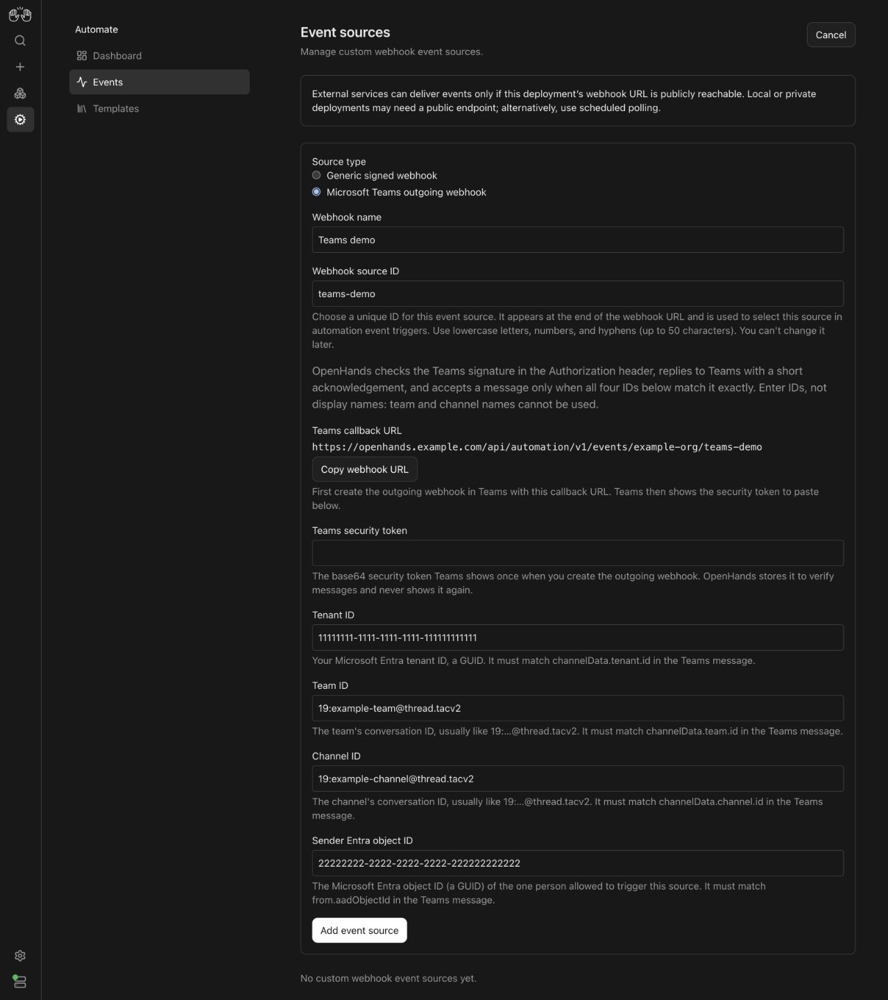
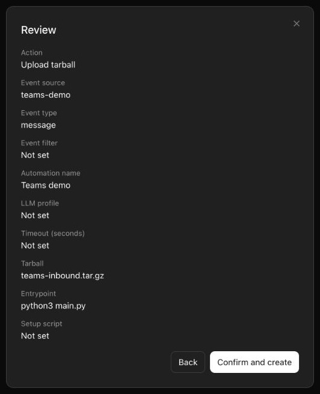

Connect Microsoft Teams and OpenHands with two webhook connections: a Teams Workflow receives notifications from OpenHands, and a Teams Outgoing Webhook starts automations from channel mentions. The [Teams example in extensions](https://github.com/OpenHands/extensions/tree/main/examples/teams-webhook) has the scripts, configuration and an optional API setup.

<Note>
This UI flow requires the unreleased Teams source option in Agent Canvas and the Automation callback-preview update. See the example's requirements before starting.
</Note>

Use a Teams work or school account and a standard test channel. The OpenHands callback must be reachable over public HTTPS.

## Send notifications to Teams

A Teams Workflow gives your channel a webhook URL: an address that accepts notifications. Your automation sends a message to that address, and the Workflow posts it in the channel.

1. In the Teams channel, open **More options → Workflows** and choose **Send webhook alerts to a channel**.
2. Select the team, channel and posting connection, then save the Workflow.
3. In OpenHands, save the Workflow URL in **Settings → Secrets** under the name your automation reads, for example `TEAMS_INBOUND_DEMO_WEBHOOK_URL`.

The extensions example is already configured to read `TEAMS_INBOUND_DEMO_WEBHOOK_URL` and send its result to that address. For your own automation, tell it which named secret to use for Teams notifications. Saving the URL as a secret does not automatically configure an automation to send messages.

The Workflow uses **Anyone** authentication, so anyone who has the full URL can post to it. Keep it secret.

## Start automations from Teams

Have your tenant, team, channel and allowed sender IDs ready; display names do not work. The [extensions example](https://github.com/OpenHands/extensions/tree/main/examples/teams-webhook#receive-teams-commands-directly) explains which IDs to use.

Screenshots use illustrative values; the security token is omitted.

1. Open **Automate → Events → Add event source** and set **Source type** to **Microsoft Teams outgoing webhook**.
2. Enter a name and a **Webhook source ID**, such as `teams-demo`. Copy the **Teams callback URL** that appears.
3. In Teams, open **Manage team → Apps → Create an outgoing webhook**. Name it **OpenHands Demo**, paste the callback URL and create it. Teams shows a security token once.
4. In OpenHands, enter the **Teams security token**, **Tenant ID**, **Team ID**, **Channel ID** and **Sender Entra object ID**, then select **Add event source**.

   

5. On the **Automate** Dashboard, open **Custom automation** and select **Continue**. Choose **Upload tarball** and **Event**, select your source, and enter `message` as the **Event type**. Upload the [packaged example](https://github.com/OpenHands/extensions/tree/main/examples/teams-webhook#connect-the-deterministic-example), use `python3 main.py` as the entrypoint, then select **Continue → Confirm and create**.

   

6. In the channel, pick the webhook from Teams' mention suggestions and send:

```text
@OpenHands Demo verify TEAMS-INBOUND-001
```

Teams shows an immediate acknowledgement, the run appears in Canvas, and a separate result card is posted in the channel. The example posts a fixed synthetic result and doesn't run an AI task.

OpenHands verifies the Teams signature and requires all four IDs to match. Outgoing Webhooks support channel mentions. DMs, conversational follow-ups and channel history require a Teams application and appropriate APIs.
