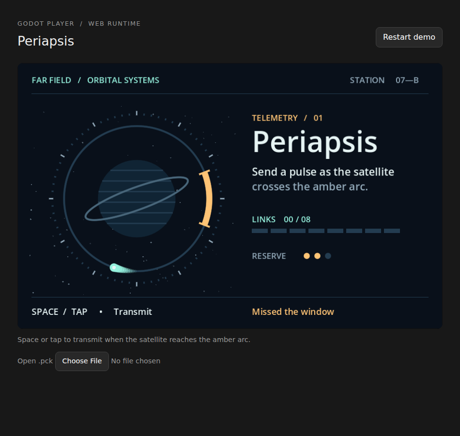

Pick one game mechanic, describe how it should feel, and playtest the change. This walkthrough uses *Periapsis*, a one-button Godot game: you’ll ask OpenHands to make the first target easier to hit, then compare the result with the original in Agent Canvas. You don't need to install Godot to play the bundled game.

## Play the Original

1. In [Apps for Agent Canvas](/openhands/usage/agent-canvas/canvas-extensions), choose `Add app`. Use `https://github.com/OpenHands/extensions` as the source, `1f4d2270f67cfe39b4ec19d239c567b780e22df1` as the Git ref, and `apps/godot-player` as the repository path.
2. Review the [Godot Player source](https://github.com/OpenHands/extensions/tree/1f4d2270f67cfe39b4ec19d239c567b780e22df1/apps/godot-player), enable the trusted app, and open `Godot Player`.
3. Tap the playfield or press Space as the satellite crosses the amber arc. A hit adds a link; a miss costs one reserve. Make eight links before you miss three times.



## Change the Game and Compare

Open a Canvas conversation in a checkout of `OpenHands/extensions` at the revision above. To export a new pack, the agent's workspace needs Godot 4.4.1 and the matching Web export templates. Try this prompt:

```text
In apps/godot-player/demo, make the first relay's amber arc twice as wide.
Keep the other seven relays unchanged. Make sure the drawn arc matches the
window that counts as a hit. Run the win, loss, and restart checks, then
export the Web release and tell me where to find the .pck. Don't rebuild
or reinstall the player.
```

Bring the exported `.pck` to the device running your browser. In Godot Player, choose `Open .pck` and select the file. Look for the wider first arc and try transmitting near its edge. After the first hit, check that the second arc returns to its original width. Choose `Restart demo` to compare with the bundled original. The file stays in your browser.
