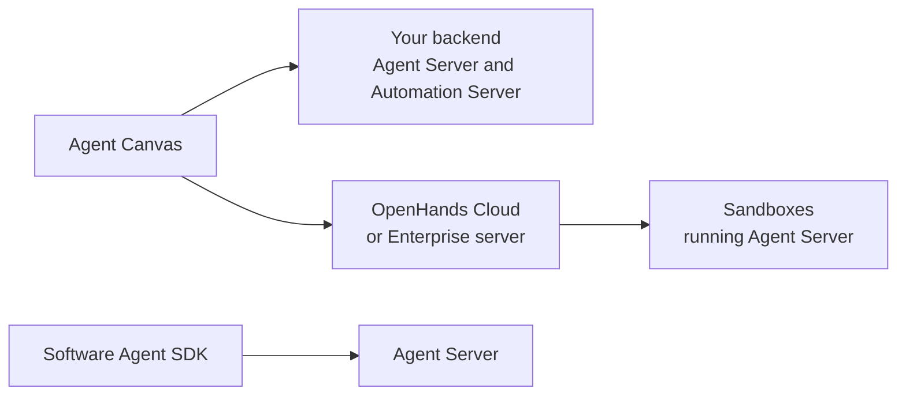

OpenHands is an open platform for running AI coding agents across real engineering work. Run agents in conversations,
automate them with schedules and events, extend them with skills, plugins, and MCP servers, and build your own agents
with the Software Agent SDK. Use any LLM, or connect an existing coding agent such as Claude Code or Codex.

We'd love for you to [join the community on Slack](https://openhands.dev/joinslack).

## Choose a Product

| Product | Use It When | Where Agents Run |
|---|---|---|
| [Agent Canvas](#agent-canvas) | You want a free, open-source workspace on your own machine or server | Your laptop, a VM, Docker, or another backend you connect |
| [OpenHands Cloud](#openhands-cloud) | You want to start without installing anything | Hosted sandboxes at [app.all-hands.dev](https://app.all-hands.dev) |
| [OpenHands Enterprise](#openhands-enterprise) | Your organization needs self-hosting, access control, and governance | Your own infrastructure |
| [Software Agent SDK](#software-agent-sdk-and-agent-server) | You want to build agents or embed them in your own tools | Your code, or an Agent Server you deploy |

We recommend starting with [Agent Canvas](/openhands/usage/agent-canvas/setup) or
[OpenHands Cloud](https://app.all-hands.dev). See the [Quick Start](/overview/quickstart).

## How the Products Fit Together

Every product runs agents with the Software Agent SDK. Agent Canvas, OpenHands Cloud, and OpenHands Enterprise share
the same Agent Canvas interface and differ in where the backend runs and who manages it.

- **Agent Server** runs the agent, its tools, and its conversations. It's part of the Software Agent SDK.
- **Automation Server** runs automations on a schedule or in response to events.
- **OpenHands Cloud and Enterprise** add accounts, sandboxes, integrations, and administration on top of Agent Server
  and Automation Server.

## Agent Canvas

[Agent Canvas](/openhands/usage/agent-canvas/overview) is the open-source workspace for running agents. Use it to run
several conversations in parallel, connect agents such as Claude Code or Codex through the Agent Client Protocol, and
create automations.

Install Agent Canvas with npm, npx, or Docker, or try the desktop app, which is in preview. By default, Agent Canvas
starts a backend on your machine. You can also connect it to a VM, Docker, or OpenHands Cloud.

[Install Agent Canvas](/openhands/usage/agent-canvas/setup) or
[view the source](https://github.com/OpenHands/OpenHands).

## OpenHands Cloud

[OpenHands Cloud](/openhands/usage/cloud/openhands-cloud) is the free hosted version of OpenHands. It runs the same
application as OpenHands Enterprise, with Agent Canvas, for a single user. Cloud includes hosted sandboxes, Git and
Slack integrations, and public webhook URLs for event automations. OpenHands Cloud limits how many conversations you
can run.

[Sign in to OpenHands Cloud](https://app.all-hands.dev).

## OpenHands Enterprise

[OpenHands Enterprise](/enterprise/overview) runs on your own infrastructure. It adds organizations, roles, single
sign-on, service accounts, budgets, and built-in integrations such as GitHub, Jira Data Center, and Azure DevOps. Use
Docker Compose for trials and the Teams plan, and Kubernetes for production.

Manage your license, subscription, and support in [Customer Center](https://customercenter.openhands.dev). Learn more
at [openhands.dev/enterprise](https://openhands.dev/enterprise).

## Software Agent SDK and Agent Server

The [Software Agent SDK](/sdk) is a Python library for building agents that work with code. The same repository
contains Agent Server, which exposes agent execution, conversations, tools, and workspaces through REST and WebSocket
APIs.

[Get started with the SDK](/sdk/getting-started) or
[view the source](https://github.com/OpenHands/software-agent-sdk).

## Features in Every Product

These guides apply to Agent Canvas, OpenHands Cloud, and OpenHands Enterprise. Each guide notes where a product
differs.

- [Automations](/openhands/usage/automations/overview): Run agents on a schedule or in response to events.
- [Skills](/overview/skills), [Plugins](/overview/plugins), and [MCP](/overview/model-context-protocol): Give agents
  knowledge and tools.
- [LLM Configuration](/openhands/usage/llms/llms): Choose a model and provider.

## Component and Repository Map

| Component | Responsibility | Source |
|-----------|----------------|--------|
| **Agent Canvas** | Agent workspace and local stack | [`OpenHands/OpenHands`](https://github.com/OpenHands/OpenHands) |
| **Software Agent SDK** | Agent framework, tools, conversations, and workspaces | [`OpenHands/software-agent-sdk`](https://github.com/OpenHands/software-agent-sdk) |
| **Agent Server** | Remote agent execution API | [`OpenHands/software-agent-sdk`](https://github.com/OpenHands/software-agent-sdk/tree/main/openhands-agent-server) |
| **Automation Server** | Scheduled and event-driven automation lifecycle | [`OpenHands/automation`](https://github.com/OpenHands/automation) |
| **Extensions** | Reusable skills, plugins, and automation templates | [`OpenHands/extensions`](https://github.com/OpenHands/extensions) |
| **Sandbox Server** | Community-supported standalone API and sandbox control plane | [`OpenHands/sandbox-server`](https://github.com/OpenHands/sandbox-server) |
| **Documentation** | Documentation for the OpenHands ecosystem | [`OpenHands/docs`](https://github.com/OpenHands/docs) |
| **Evaluations** | Benchmark and evaluation infrastructure | [`OpenHands/benchmarks`](https://github.com/OpenHands/benchmarks) |

Each public repository includes its own license. Check the repository you use or modify instead of assuming one
license applies to the entire ecosystem.

## Legacy

The [OpenHands CLI](https://github.com/OpenHands/OpenHands-CLI) is no longer actively maintained. The legacy local GUI
launched with `openhands serve` is deprecated. For a maintained local installation, use
[Agent Canvas](/openhands/usage/agent-canvas/setup#install-and-run).

The archived [`OpenHands/legacy`](https://github.com/OpenHands/legacy) repository preserves the previous backend and
runtime source for reference.

## Community

Explore all [OpenHands repositories](https://github.com/orgs/OpenHands/repositories) and
[join us on Slack](https://openhands.dev/joinslack).
